# Dokumen Teknis Modul 4: Next.js App Router

Nama: Erlangga Aditya Permana
NIM: 105224038
Repositori: <https://github.com/xvasgit/PrivateSession>  
Branch kerja: `praktikum/modul-04`  
Versi Next.js dan mode Cache Components (aktif/tidak): **16.4.0; tidak aktif**

## 1. Peta Rute

Padanan `/tentang` adalah `/about/`; `/katalog` adalah `/upload/samples/`; `/katalog/[id]` adalah `/upload/samples/[sampleId]/`. Contoh review sintetis tetap berada dalam alur Upload & Review, bukan pustaka sesi tersimpan.

| URL                           | Berkas di `app/`                     | Jenis rute                    | Isi halaman                                        |
| ----------------------------- | ------------------------------------ | ----------------------------- | -------------------------------------------------- |
| `/`                           | `page.tsx`                           | Statis                        | Overview                                           |
| `/live/`                      | `live/page.tsx`                      | Statis dengan interaksi klien | Persiapan live, transcript sintetis, demo enkripsi |
| `/upload/`                    | `upload/page.tsx`                    | Statis dengan interaksi klien | Metadata file, analisis sintetis, demo enkripsi    |
| `/about/`                     | `about/page.tsx`                     | Statis                        | Deskripsi dan batas kemampuan produk               |
| `/upload/samples/`            | `upload/samples/page.tsx`            | Statis                        | Daftar dua contoh review                           |
| `/upload/samples/[sampleId]/` | `upload/samples/[sampleId]/page.tsx` | Segmen dinamis                | Detail; ID 1/2 diprerender                         |

Potongan keluaran `npm.cmd run build` setelah penghapusan `app/uji/`, diverifikasi pada 18 Oktober 2026:

```text
Route (app)
┌ ○ /
├ ○ /_not-found
├ ○ /about
├ ○ /live
├ ○ /upload
├ ○ /upload/samples
└   /upload/samples/[sampleId]
  ├ ● /upload/samples/1
  └ ● /upload/samples/2

○  (Static)   prerendered as static content
●  (SSG)      prerendered as static HTML (uses generateStaticParams)
```

`/_not-found` merupakan entri internal framework. Struktur `[sampleId]` tetap merupakan segmen dinamis meskipun dua contoh dikenal diprerender. `/sessions/` tidak tersedia.

**Bukti N1 — navigasi Link dan reload.**

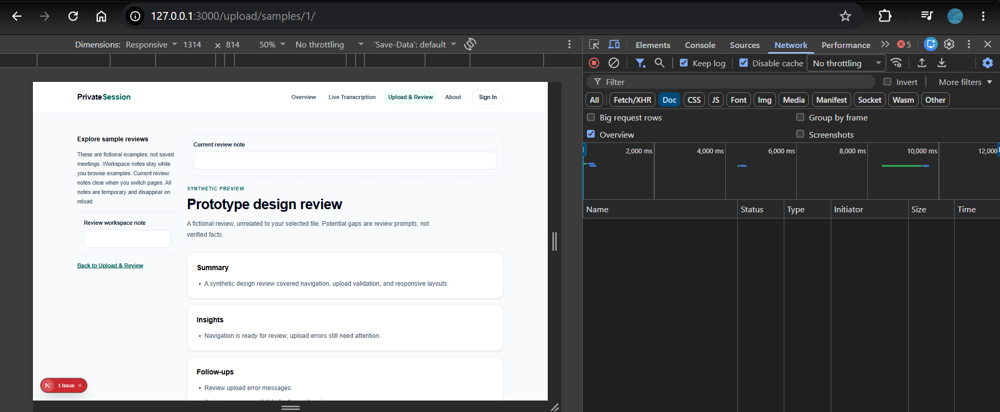

URL menunjukkan `/upload/samples/1/`, menu Upload & Review aktif, Keep log aktif, dan filter Doc tidak memperlihatkan permintaan document setelah navigasi Link.

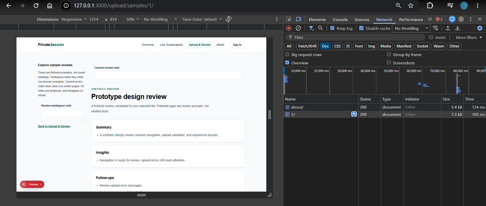

Reload menampilkan permintaan document `1/` berstatus 200, beserta log awal `about/`. Gambar reload berasal dari pengambilan sebelumnya; kedua gambar menunjukkan perbedaan perilaku, bukan satu rekaman percobaan berkesinambungan.

## 2. Layout, Template, dan Berkas Khusus

### 2.1 Layout dan template

Pohon folder setelah penghapusan rute sementara. Fallback produk pada `upload/samples/` tetap dipertahankan.

```text
app/
├── globals.css
├── layout.tsx
├── page.tsx
├── not-found.tsx
├── about/page.tsx
├── live/page.tsx
└── upload/
    ├── page.tsx
    └── samples/
        ├── layout.tsx
        ├── template.tsx
        ├── loading.tsx
        ├── error.tsx
        ├── page.tsx
        └── [sampleId]/
            ├── page.tsx
            └── not-found.tsx
```

Root layout memakai AppShell untuk header, navigasi, satu `main`, dan footer. Layout samples menyisipkan **Review workspace note**, sedangkan template menyisipkan **Current review note**. Keduanya memakai ReviewNote dengan `useId` dan `useState`.

Layout bersama bertahan pada navigasi antarsegmen anak; template dipasang ulang sehingga state catatannya kosong. Reload mengosongkan keduanya. Catatan hanya berada di memori browser, tanpa localStorage/sessionStorage atau pengiriman ke server. Perubahan query string saja bukan uji reset template.

| Skenario            | Harapan                                     | Hasil otomatis           |
| ------------------- | ------------------------------------------- | ------------------------ |
| Daftar → detail 1   | Workspace bertahan, current kosong          | Lulus di 390/768/1280 px |
| Detail 1 → detail 2 | Layout bertahan, template reset             | Lulus di tiga viewport   |
| Detail 2 → daftar   | Layout bertahan, template reset             | Lulus di tiga viewport   |
| Reload              | Kedua catatan kosong; tidak ada web storage | Lulus di tiga viewport   |

**Bukti L1 — sebelum, detail, dan kembali ke daftar.**

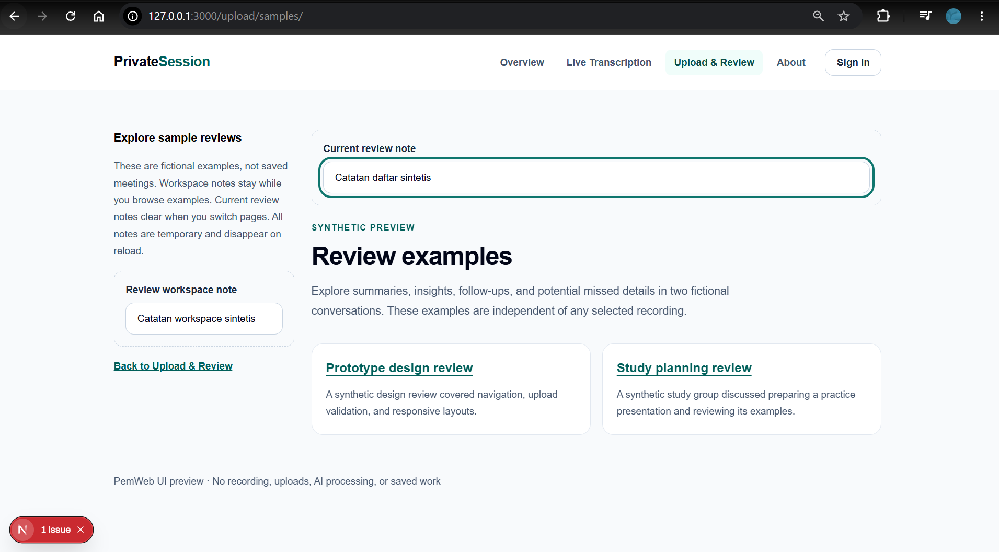

Workspace berisi `Catatan workspace sintetis`; current review berisi `Catatan daftar sintetis`.

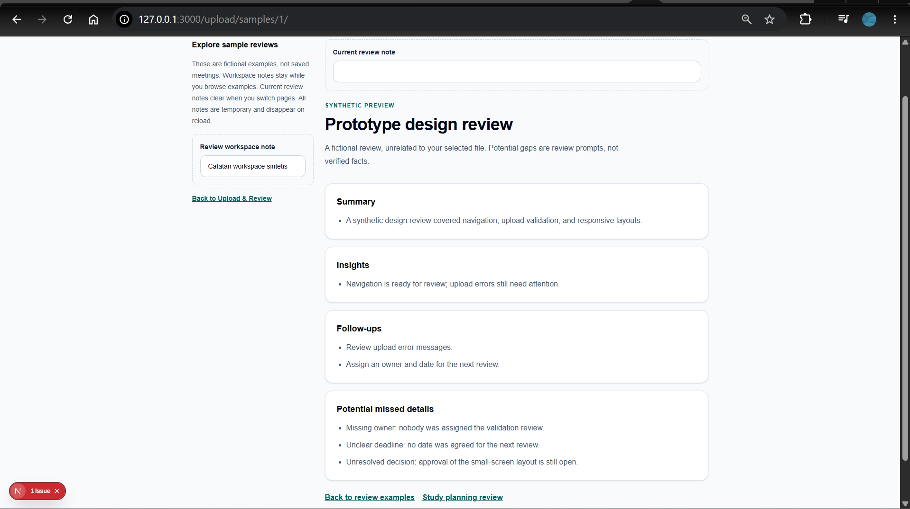

Pada detail 1, workspace tetap berisi nilai yang sama dan current review kosong.

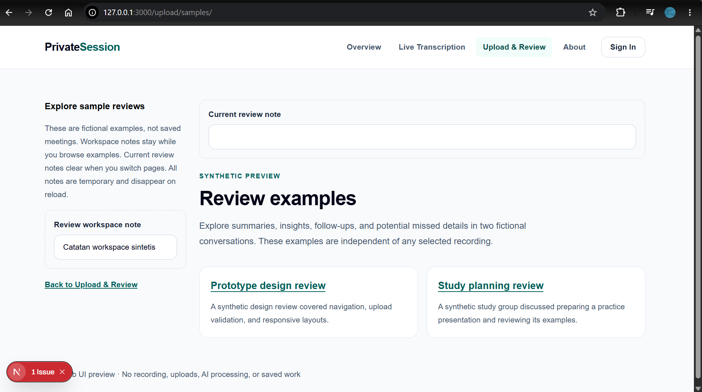

Gambar yang diperbarui berada di `/upload/samples/`. Workspace tetap berisi dan current review kosong, sesuai perilaku layout/template.

### 2.2 Loading dan error

Fallback produk di `upload/samples/loading.tsx` memakai `role="status"`; error boundary memakai `role="alert"` dan `retry()`. Keduanya tetap dipertahankan setelah praktikum. Karena data sintetis lokal cepat dan sebagian diprerender, loading pada rute produk belum tentu terlihat.

Saat pengambilan bukti, fixture `/uji/lambat/` memanggil `await connection()` lalu menunggu dua detik. Fixture `/uji/galat/` memanggil connection lalu melempar `Synthetic review source failed (Module 4 test)`. Boundary segmen menangkap galat halaman tanpa mengganti shell; tidak menangkap galat layout/template pada segmen yang sama.

**Status akhir:** `app/uji/` dan `tests/e2e/module-04-lab.spec.ts` telah dihapus setelah pengambilan bukti. Gambar di bawah adalah dokumentasi pengujian sebelum penghapusan; rute uji tidak lagi tersedia pada struktur aplikasi saat ini.

Pengambilan sebelumnya dilakukan mahasiswa pada port 3000: jalankan `npm.cmd run dev` untuk dev; hentikan server, lalu `npm.cmd run build` dan `npm.cmd start` untuk produksi. Hanya satu server memakai port tersebut pada satu waktu.

**Bukti L2 — loading dev dan produksi.**

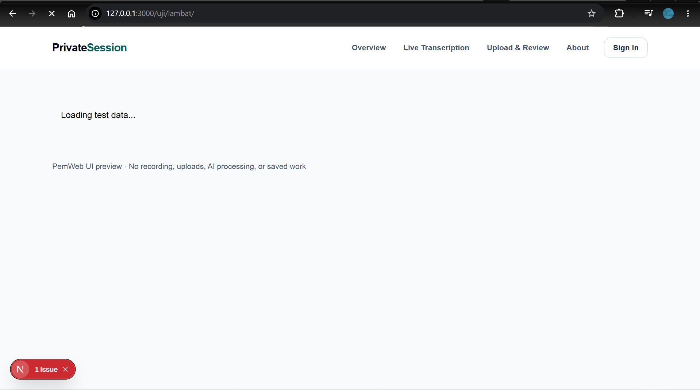

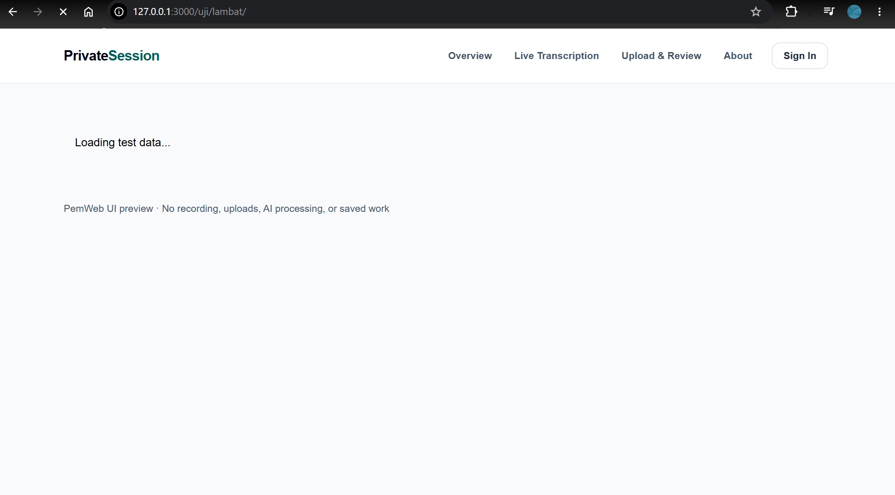

Keduanya menunjukkan `/uji/lambat/`, `Loading test data...`, header, dan footer. Label mode mengikuti berkas mahasiswa; gambar dev juga memperlihatkan indikator Next.js.

**Bukti L3 — error dev dan produksi.**

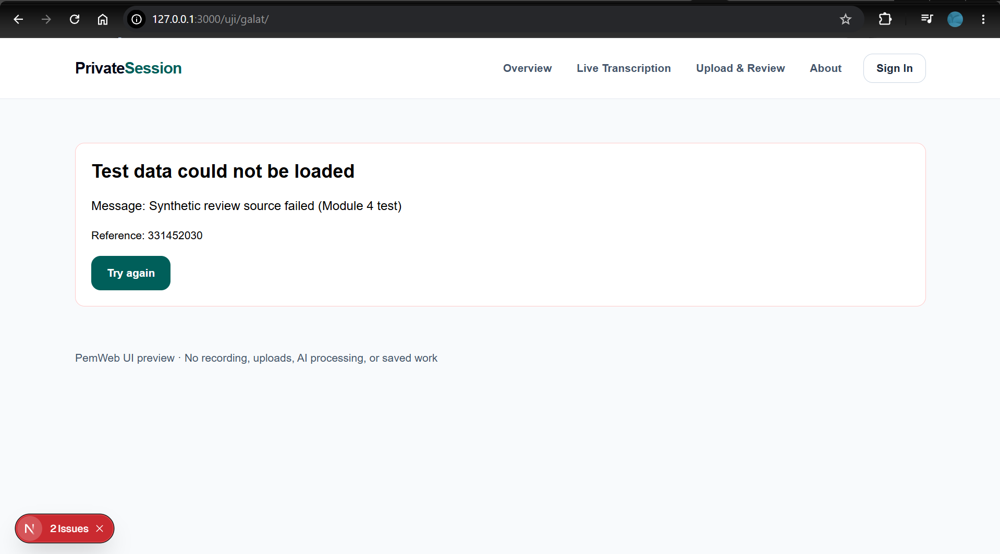

Dev menampilkan pesan sintetis asli dan Reference `331452030`.

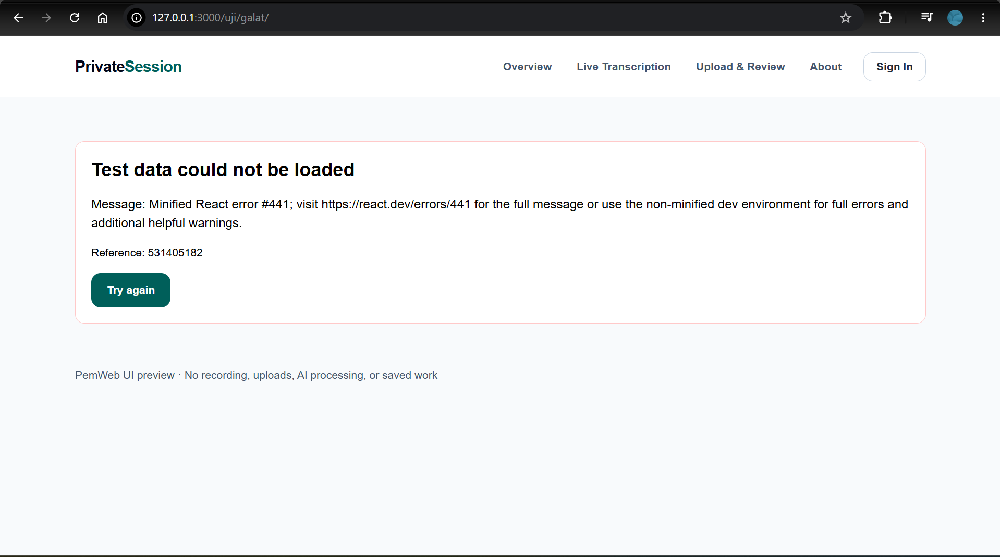

Produksi menampilkan `Minified React error #441` dan Reference `531405182`, tanpa pesan sintetis asli. Digest dapat berubah antarbuild. Header/footer serta Try again terlihat. Gambar diam membuktikan tampilan tombol, bukan hasil klik; retry telah diuji otomatis. Fixture selalu gagal sehingga galat muncul lagi setelah retry. Pesan asli di terminal server adalah perilaku yang diharapkan.

Pemeriksaan DOM sebelumnya pada Chromium 156.0.8078.4, port 3102 (dev) dan 3101 (produksi), mengonfirmasi loading, shell, serta perbedaan pesan tersebut tanpa mengambil screenshot. Seluruh gambar di dokumen diambil manual oleh mahasiswa.

## 3. Rute Dinamis dan Validasi params

Detail menerima `params: Promise<{ sampleId: string }>`. Implementasi melakukan `await params`, memvalidasi pola `^[1-9]\d*$`, mengonversi dengan Number, memeriksa `Number.isSafeInteger`, lalu mencari ID pada data sintetis. Kegagalan format maupun pencarian memanggil `notFound()`. ID 1/2 dihasilkan melalui `generateStaticParams`; format benar tidak menjamin data tersedia.

Hasil aktual curl produksi pada `http://127.0.0.1:3101` menggunakan trailing slash agar tidak mengukur redirect; tampilan juga diperiksa dengan Playwright pada port 3000.

| URL                                 | Harapan                                         | Aktual | Status curl |
| ----------------------------------- | ----------------------------------------------- | ------ | ----------- |
| `/upload/samples/1/`                | Detail Prototype design review                  | Sesuai | 200         |
| `/upload/samples/2/`                | Detail Study planning review                    | Sesuai | 200         |
| `/upload/samples/abc/`              | Format ditolak; not-found segmen                | Sesuai | 404         |
| `/upload/samples/0/`                | Nol ditolak                                     | Sesuai | 404         |
| `/upload/samples/03/`               | Nol di depan ditolak                            | Sesuai | 404         |
| `/upload/samples/999/`              | Data tidak tersedia                             | Sesuai | 404         |
| `/upload/samples/9007199254740992/` | Integer tidak aman ditolak                      | Sesuai | 404         |
| `/tidak-ada/`                       | Not-found global                                | Sesuai | 404         |
| `/upload-other/`                    | Not-found global; menu Upload tidak salah aktif | Sesuai | 404         |
| `/sessions/`                        | Rute lama tidak tersedia                        | Sesuai | 404         |

Contoh pengulangan pada port produksi standar:

```powershell
curl.exe -s -o NUL -w "%{http_code}" http://127.0.0.1:3000/upload/samples/abc/
```

`notFound()` menghasilkan UI pemulihan segmen serta noindex; URL yang tidak dikenal memakai not-found global. Angka status di atas merupakan hasil run nyata, bukan asumsi dari tampilan halaman.

## 4. Pembagian Server dan Client Components

| Komponen/berkas                               | Jenis                                         | Alasan                                      |
| --------------------------------------------- | --------------------------------------------- | ------------------------------------------- |
| RootLayout                                    | Server                                        | Metadata dan kerangka dokumen               |
| OverviewPage, LivePage, UploadPage, AboutPage | Server                                        | Menyusun UI; interaksi pada anak klien      |
| ReviewSamplesPage                             | Server                                        | Merender daftar dari modul server           |
| ReviewSamplePage                              | Server                                        | Await params, validasi, pencarian, notFound |
| ReviewSamplesLayout                           | Server                                        | Layout bersama dengan ReviewNote klien      |
| ReviewSamplesTemplate                         | Server                                        | Memasang ulang subtree anak                 |
| ReviewSamplesLoading                          | Server                                        | Fallback tanpa state                        |
| ReviewSampleNotFound, NotFoundPage            | Server                                        | Pemulihan data/URL tidak ditemukan          |
| ReviewSamplesError                            | Client                                        | Boundary dan event retry                    |
| AppShell, NavigationFallback                  | Server                                        | Shell, fallback navigasi, slot children     |
| MainNavigation                                | Client                                        | usePathname dan aria-current                |
| SignInDialog                                  | Client                                        | useRef, dialog browser, event/focus         |
| LiveSetupForm                                 | Client                                        | useState dan validasi interaktif            |
| CaptureSourceSelector                         | Client melalui LiveSetupForm                  | Event dan callback induk                    |
| TranscriptPreview                             | Client                                        | State, effect, timer, kontrol demo          |
| UploadReview                                  | Client                                        | State/ref, metadata file, interaksi demo    |
| EncryptionPreview                             | Client                                        | State/ref/effect, Web Crypto lokal          |
| ReviewNote                                    | Client                                        | useId/useState dan input                    |
| ReviewSampleList                              | Server                                        | Membaca data server-only tanpa hooks        |
| FeatureCard, PageHeading                      | Server pada penggunaan saat ini               | Presentasi statis                           |
| SampleOutput                                  | Client melalui TranscriptPreview/UploadReview | Diimpor dalam graph klien                   |
| FormField                                     | Client melalui form/ReviewNote                | Input dan callback                          |
| Button                                        | Client pada penggunaan saat ini               | Diimpor form/dialog/enkripsi/error          |
| Card, Badge                                   | Shared sesuai pengimpor                       | Presentasi stateless di kedua graph         |

`lib/workflows/review-samples.server.ts` adalah modul data, bukan komponen UI. `import "server-only"` melindungi jalur impor; bukan enkripsi, sehingga data yang dirender tetap terlihat pengguna. Next.js mendukung penanda tersebut secara internal. `samples.ts` tetap kompatibel dengan klien untuk demo lama.

`tests/e2e/module-04.spec.ts` tetap dipertahankan untuk menguji fitur permanen: navigasi, layout/template, validasi parameter, dan not-found. `lib/workflows/review-samples.server.ts` juga tetap diperlukan oleh daftar/detail contoh; penghapusan rute percobaan tidak menghapus modul ini.

### Uji batas server-only

Probe sementara pada `app/uji/server-only/page.tsx`:

```tsx
"use client";
import { reviewSamples } from "@/lib/workflows/review-samples.server";

export default function InvalidClientPage() {
  return <p>{reviewSamples.length}</p>;
}
```

Build nyata ditolak dengan exit code 1 dan pesan `'server-only' cannot be imported from a Client Component module`. Trace menunjukkan impor melalui Client Component Browser/SSR. Probe telah dihapus dan build positif kembali lulus.

**Bukti S1 — penolakan compiler.**

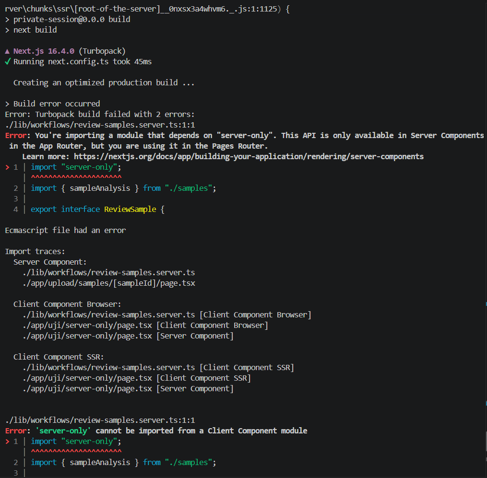

Gambar memperlihatkan penolakan dan trace menuju probe klien. Exit code berasal dari log otomatis, tidak terlihat pada gambar. Diagnostik tambahan tentang Pages Router tidak mengubah struktur App Router proyek.

**Bukti S2 — komponen server dan hooks klien.**

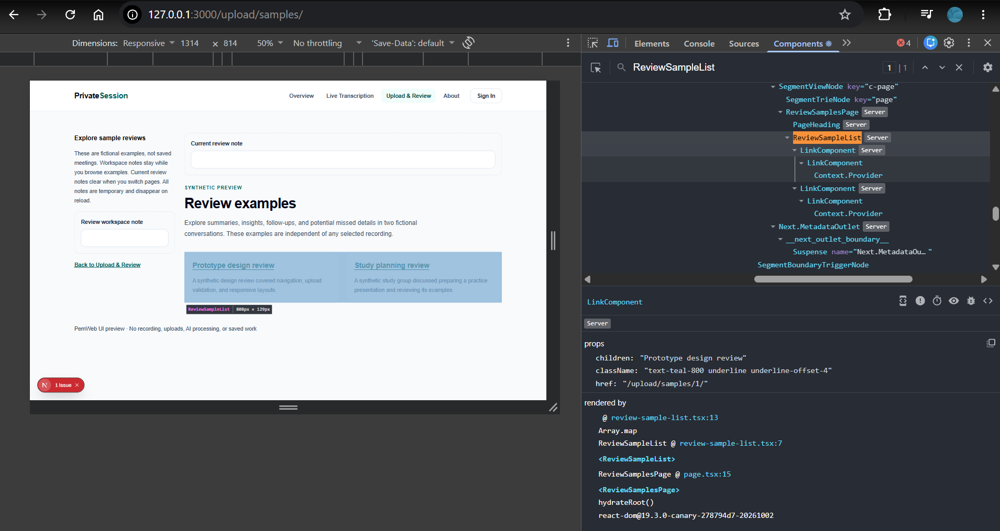

ReviewSampleList berlabel Server; panel detail menampilkan props LinkComponent anaknya. Ini merupakan bukti tambahan komponen server.

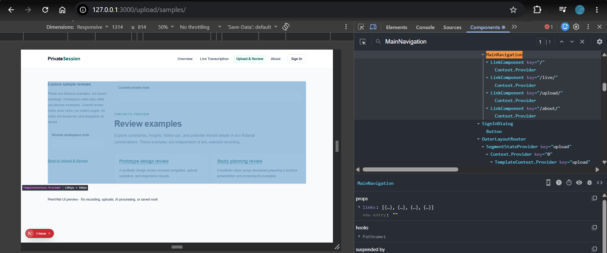

Panel memilih MainNavigation dengan props links dan hook Pathname. Hook terlihat terlipat; nilai internalnya tidak diklaim terlihat.

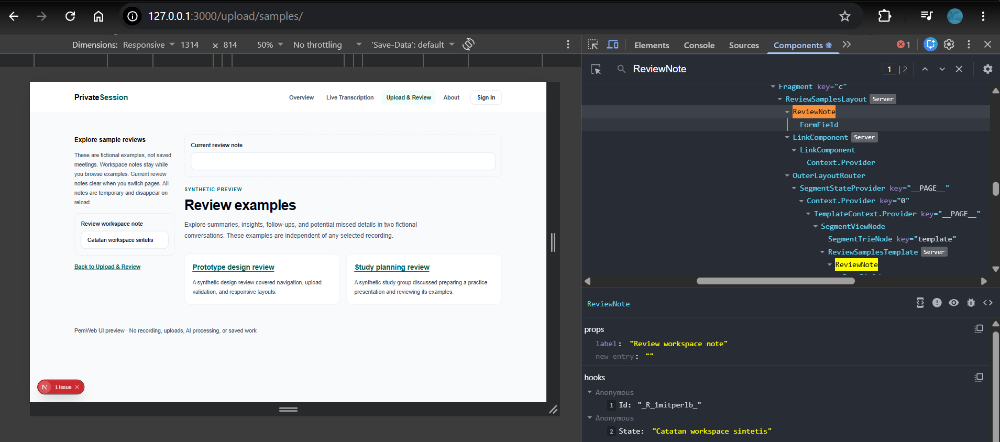

Panel memilih ReviewNote dengan label Review workspace note, hooks Id dan State. Nilai State `Catatan workspace sintetis` sama dengan input. Pohon juga menunjukkan instance pada layout dan template.

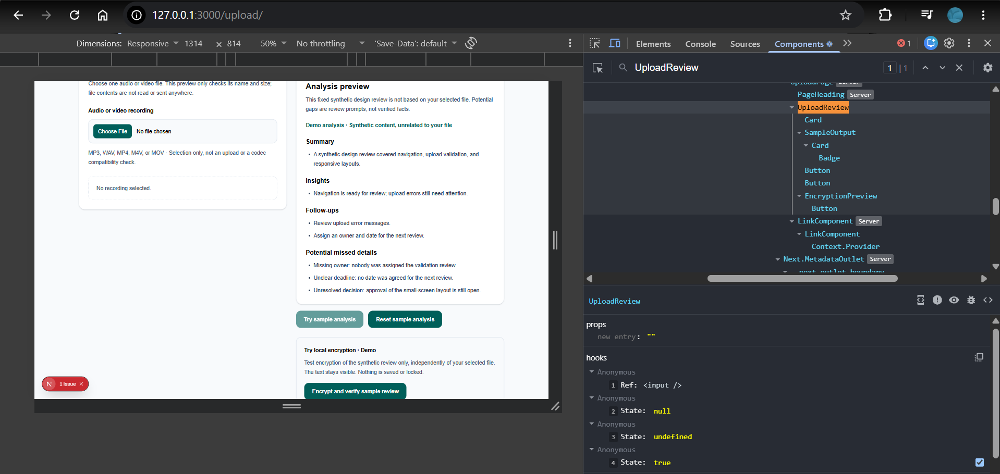

Panel UploadReview memperlihatkan Ref dan beberapa State, termasuk `true` saat hasil analisis sintetis tampil. Ini bukan pemrosesan file nyata.

Ketiga gambar tambahan memenuhi pemeriksaan keberadaan hooks klien pada E.4 langkah 6. Padanan TautanNav, DaftarItem, dan KolomCatatan adalah MainNavigation, UploadReview, dan ReviewNote.

## 5. Verifikasi

Pemeriksaan build dan check berikut dijalankan ulang pada **18 Oktober 2026 setelah penghapusan `/uji/`**. Hasil E2E dan curl sebelumnya dibedakan dari pemeriksaan terbaru.

| Pemeriksaan                          | Hasil                                                            | Bukti                                                              |
| ------------------------------------ | ---------------------------------------------------------------- | ------------------------------------------------------------------ |
| `npm.cmd run build`                  | Lulus; tabel rute tidak lagi memuat `/uji/`                      | Bagian 1 dan potongan keluaran di bawah                            |
| `npm.cmd run check`                  | Lint, typecheck, 44 unit test, dan format lulus                  | Potongan keluaran di bawah                                         |
| `tsc --noEmit`                       | Lulus melalui skrip typecheck dalam check                        | Keluaran typecheck                                                 |
| `npm.cmd run lint`                   | Lulus melalui check                                              | Keluaran eslint                                                    |
| E2E sebelum penghapusan              | 63/63 lulus pada 390/768/1280 px, termasuk tes fixture sementara | Hasil pengujian tahap bukti; bukan run setelah penghapusan         |
| E2E setelah penghapusan              | Belum dijalankan ulang dalam pembaruan ini                       | Jalankan `npm.cmd run test:e2e -- --workers=2` untuk hasil terbaru |
| Server-only                          | Compile probe ditolak sesuai harapan                             | Bagian 4; probe sudah dihapus                                      |
| HTTP sebelum penghapusan             | Valid 200, kasus negatif 404                                     | Bagian 3                                                           |
| DOM dev/produksi sebelum penghapusan | Loading/shell dan perbedaan pesan sesuai                         | Bagian 2.2                                                         |
| Screenshot dan React DevTools        | 14 gambar tersedia dan ditinjau                                  | N1, L1–L3, S1–S2                                                   |
| Pembersihan fixture                  | `app/uji/` dan tes khusus lab sudah tidak ada                    | Pemeriksaan filesystem; build terbaru lulus                        |
| Commit/push/PR                       | Dikerjakan mahasiswa; belum diverifikasi selesai                 | Tidak ada operasi tulis Git oleh agen                              |

Potongan keluaran aktual build (tabel rute lengkap di bagian 1):

```text
> private-session@0.0.0 build
> next build
▲ Next.js 16.4.0 (Turbopack)
✓ Compiled successfully in 1677ms
  Running TypeScript ...
  Finished TypeScript in 1945ms ...
✓ Generating static pages using 9 workers (9/9) in 937ms
  Finalizing page optimization ...
```

Potongan keluaran aktual check; proses selesai dengan exit code 0:

```text
> private-session@0.0.0 check
> npm run lint && npm run typecheck && npm test && npm run format:check

> private-session@0.0.0 lint
> eslint .

> private-session@0.0.0 typecheck
> tsc --noEmit

> private-session@0.0.0 test
> vitest run
 Test Files  5 passed (5)
      Tests  44 passed (44)

> private-session@0.0.0 format:check
> prettier --check app components lib tests scripts *.json *.mjs *.ts .github/workflows/*.yml
Checking formatting...
All matched files use Prettier code style!
```

Playwright melakukan asersi DOM, navigasi, HTTP, dan state tanpa screenshot/video/trace. Uji lama tetap mencakup live/upload, validasi, dialog, privasi, serta enkripsi. Angka 63 adalah hasil historis yang mencakup tes sementara; bukan jumlah hasil terbaru setelah tes lab dihapus. Status HTTP `/uji/lambat/` dan `/uji/galat/` setelah penghapusan belum diukur ulang dalam pembaruan ini. Hasil otomatis tidak menggantikan demonstrasi mahasiswa.

## 6. Kendala dan Penyelesaian

| Kendala/keputusan                                              | Penyelesaian dan batasnya                                                                                                                                                                                |
| -------------------------------------------------------------- | -------------------------------------------------------------------------------------------------------------------------------------------------------------------------------------------------------- |
| Ekspor statis tidak melayani connection saat permintaan        | Hapus `output: "export"`; gunakan Next.js runtime lokal. Build default menghasilkan `.next/`, bukan `out/`. Cache Components tetap tidak aktif.                                                          |
| Contoh katalog generik tidak sesuai produk                     | Gunakan contoh review di bawah Upload & Review. Deskripsi produk dan status fitur dipertahankan; About memakai deskripsi yang sama.                                                                      |
| API dan contoh lama berpotensi keliru                          | Periksa panduan Next.js 16.4.0 terpasang: params Promise, server-only, template, loading, not-found, connection, dan retry.                                                                              |
| PowerShell memblokir npm.ps1                                   | Gunakan npm.cmd/npx.cmd; tidak mengubah execution policy.                                                                                                                                                |
| Selector error menangkap dua role alert                        | Batasi selector ke main karena Next.js juga memiliki route announcer. Run awal 60 lulus/3 gagal; setelah perbaikan seluruh 63 tes lulus. Riwayat koreksi di bagian 6.                                    |
| Teardown Playwright tertahan sandbox Windows                   | Hentikan hanya server tes milik run tersebut setelah memverifikasi PID/path; run ulang di luar sandbox selesai normal.                                                                                   |
| Pesan compiler menyebut Pages Router dalam diagnostik tambahan | Proyek tetap App Router. Dasar diagnosis adalah penolakan server-only dan import trace Client Component yang nyata, bukan migrasi ke Pages Router.                                                       |
| Bukti manual memerlukan koreksi                                | Gambar navigasi dan kembali ke daftar sudah diperbaiki; tiga gambar hooks klien ditambahkan. Seluruh 14 gambar telah ditinjau. Fixture dan tes lab telah dihapus; build/check setelah penghapusan lulus. |
| Baseline KKS menggunakan static export                         | Catat perubahan runtime sebagai delta arsitektur. DFD, risiko, tag, dan bukti lama tidak ditulis ulang atau diklaim memverifikasi runtime baru.                                                          |

Server baru hanya melayani rendering/data sintetis di loopback. Form, metadata file, catatan sementara, dan kriptografi tetap lokal di browser. Tidak ada backend API aplikasi, database, capture, upload nyata, inference, autentikasi, atau persistence baru. Pemakaian kembali UI pada desktop tetap merupakan tujuan; kompatibilitas paket desktop/static export perlu ditinjau tersendiri sebelum integrasi atau merge.

## 7. Catatan Pemanfaatan AI

- **Alat:** ChatGPT (Codex), sebagai agen engineering.
- **Perintah utama:** mengevaluasi PDF Modul 4 bagian E/H; merencanakan dan menerapkan routing pada branch praktikum tanpa operasi tulis Git; mempertahankan tujuan/deskripsi produk; menyusun dokumen dan petunjuk screenshot manual.
- **Bagian yang digunakan:** rute About dan contoh review, data server-only, catatan layout/template, fallback, fixture sementara, konfigurasi runtime/navigasi, tes browser, dokumentasi teknis, serta log pemeriksaan.
- **Cara verifikasi:** membaca source dan dokumentasi Next.js terpasang; menjalankan lint/typecheck/44 unit test, build, uji negatif compiler, curl dan 63 E2E pada tahap bukti; build/check dijalankan ulang setelah penghapusan fixture. Bukti pengujian berupa keluaran asli, bukan hasil yang diperkirakan.
- **Batas bantuan:** tidak mengerjakan Tes pada bagian G, tidak membuat screenshot, tidak mengisi identitas, tidak mengubah tujuan produk, tidak melakukan operasi tulis Git. Fixture telah dihapus oleh saya; build/check setelah penghapusan lulus. E2E serta pemeriksaan HTTP rute yang dihapus belum diulang dalam pembaruan ini.
- **Verifikasi manusia:** Saya telah mengambil 14 gambar; perlu memeriksa hasil, menyesuaikan uraian dengan pengamatannya, serta mampu menjelaskan kode dan keputusan teknis.
