# Dokumen Teknis Modul 5 — Formulir, Validasi, Session, dan Cookie

Nama/NIM: Erlangga Aditya Permana / 105224038  
Repositori: <https://github.com/xvasgit/PrivateSession>  
Branch kerja: `praktikum/modul-05`  

Dokumen ini membahas **demo review-request** PrivateSession: pengguna masuk dengan akun lab sintetis, mengirim metadata permintaan review, lalu melihat daftar dan detail record sementara. Demo dapat dibuka melalui Upload & Review atau `/demo-sign-in/`. Tidak ada unggahan media, transkripsi, analisis AI, akun produksi, atau penyimpanan permanen dalam alur ini.

Validasi nama/ukuran rekaman pada `/upload/` tetap merupakan alur terpisah. Formulir practicum tidak membutuhkan file dan tidak menjadwalkan pemrosesan. Konfirmasi data sintetis bukan bukti persetujuan peserta rapat. Record demo tidak dienkripsi oleh demonstrasi Web Crypto yang tersedia di bagian lain aplikasi.


## 1. Skema Validasi

Skema Zod 4 berada di [schema.ts](../../lib/practicum/schema.ts). Tipe `ReviewRequestInput` diturunkan dengan `z.infer<typeof reviewRequestSchema>`, sehingga tipe hasil mengikuti skema. Validasi awal browser memakai atribut HTML; validasi otoritatif memakai `safeParse` di Server Action.

| Kolom / nama data                  | Aturan Zod                                                                      | Pesan galat untuk pelanggaran aturan                                                                   |
| ---------------------------------- | ------------------------------------------------------------------------------- | ------------------------------------------------------------------------------------------------------ |
| Meeting title / `title`            | `z.string().trim().min(3).max(80)`                                              | `Meeting title must be at least 3 characters.` / `Meeting title must be at most 80 characters.`        |
| Meeting type / `meetingType`       | `z.enum(meetingTypes)`; hanya `Online Meeting`, `Lecture`, `Interview`, `Other` | `Choose a meeting type.`                                                                               |
| Review context / `context`         | `z.string().trim().min(10).max(500)`                                            | `Review context must be at least 10 characters.` / `Review context must be at most 500 characters.`    |
| Demo confirmation / `confirmation` | `z.stringbool().default(false).refine(Boolean)`                                 | `Confirm synthetic information and temporary storage.` untuk nilai false atau kolom yang tidak dikirim |

`trim()` dijalankan sebelum pemeriksaan panjang. Checkbox HTML yang dicentang mengirim string `on`, lalu diparsing menjadi boolean `true`; checkbox yang tidak dicentang tidak mengirim kolom sehingga nilai default `false` ditolak. String boolean yang tidak dikenali, tipe salah, atau kolom string yang hilang menghasilkan galat bawaan Zod; bukan semua masukan rusak memakai pesan kustom pada tabel. Kolom tambahan dibuang oleh `z.object`, termasuk percobaan mengirim `owner` sendiri.

Formulir masuk memakai `demoSignInSchema`: `email` harus lolos `z.email("Enter a valid demo email.")`, sedangkan `password` minimal delapan karakter dengan pesan `Demo password must be at least 8 characters.` Konfigurasi akun yang kosong/tidak valid menghentikan proses masuk dengan pesan setup yang aman.

**Aturan semantik:** judul tidak boleh sama tanpa membedakan huruf besar/kecil pada record milik akun yang sama. Setelah skema berhasil, `createRecord(session.owner, parsed.data)` melakukan pencarian duplikat dan penyisipan secara sinkron, tanpa `await` di antaranya. Duplikat mengembalikan galat `title`: `You already have a demo request with this title.` Record sebelumnya tetap ada.

Aturan tersebut membutuhkan state server sehingga tidak cukup dikerjakan oleh skema bentuk saja. Pemilik selalu berasal dari sesi. Judul sama pada pemilik berbeda diperbolehkan oleh store, meskipun antarmuka lab saat ini hanya menyediakan satu akun sintetis. Jaminan pemeriksaan dan penyisipan ini hanya berlaku pada satu proses, bukan transaksi database lintas instance.

## 2. Alur Server Action

```text
Browser mengirim form
  -> periksa sesi server
  -> safeParse bentuk/nilai input
  -> periksa duplikat judul per pemilik
  -> buat record sementara
  -> revalidatePath("/upload/practicum")
  -> redirect ke /upload/practicum/[id]/
```

Urutan dalam [createDemoRequest](../../app/upload/practicum/actions.ts):

1. `readDemoSession()` memeriksa ID cookie terhadap store dan waktu kedaluwarsa. Jika tidak sah, kembalikan `Please sign in to the demo again. No request was created.` sebelum memvalidasi formulir.
2. `reviewRequestSchema.safeParse(Object.fromEntries(data))` memeriksa input secara independen dari browser. Kegagalan dikembalikan melalui `z.flattenError(parsed.error).fieldErrors` dan pesan `Check the request fields.`
3. `practicumStore.createRecord` memeriksa semantik dan melakukan mutasi. Record berisi data tervalidasi, ID acak, pemilik dari sesi, dan timestamp UTC.
4. Kegagalan tak terduga dalam mutasi mengembalikan pesan umum untuk mencoba lagi. Diagnostik hanya mencatat `Demo request creation failed.`, tanpa isi formulir, credential, atau cookie.
5. Setelah mutasi berhasil, invalidasi halaman daftar lalu pindahkan pengguna ke detail. Kedua pemanggilan berada **di luar `try` mutasi** agar `redirect` tidak tertangkap sebagai kegagalan penyimpanan.

Potongan aktual bagian akhir aksi:

```ts
  } catch {
    console.error("Demo request creation failed.");
    return { message: "Could not create the demo request. Please retry." };
  }
  revalidatePath("/upload/practicum");
  redirect(`/upload/practicum/${id}/`);
```

| Lapisan               | Berkas utama                                                                                                                                            | Tanggung jawab                                                                                                                  |
| --------------------- | ------------------------------------------------------------------------------------------------------------------------------------------------------- | ------------------------------------------------------------------------------------------------------------------------------- |
| Server Component      | [daftar](../../app/upload/practicum/page.tsx), [form baru](../../app/upload/practicum/new/page.tsx), [detail](../../app/upload/practicum/[id]/page.tsx) | Memverifikasi sesi sebelum render; daftar/detail hanya membaca record pemilik tersebut                                          |
| Client Component      | [request-form.tsx](../../components/practicum/request-form.tsx), [sign-in-form.tsx](../../components/practicum/sign-in-form.tsx)                        | Input terkontrol, galat per kolom, status dan tombol pending                                                                    |
| Hook klien            | [use-demo-action.ts](../../components/practicum/use-demo-action.ts)                                                                                     | Membungkus `useActionState`; menangani kegagalan jaringan sambil meneruskan kontrol redirect Next.js melalui `unstable_rethrow` |
| Berkas `"use server"` | [aksi request](../../app/upload/practicum/actions.ts), [aksi masuk/keluar](../../app/demo-sign-in/actions.ts)                                           | Validasi, mutasi record/sesi, cookie, revalidasi, redirect                                                                      |
| Modul `server-only`   | [session.server.ts](../../lib/practicum/session.server.ts), [store.server.ts](../../lib/practicum/store.server.ts)                                      | Pembacaan cookie asinkron, verifikasi sesi, penyimpanan sementara dan isolasi pemilik                                           |

Kontrak aksi adalah `(previous: DemoFormState, data: FormData) => Promise<DemoFormState>`, dengan `fieldErrors` dan `message` opsional. Ini Server Action internal, bukan REST API publik. Jalur berhasil berpindah halaman melalui `redirect`, bukan mengembalikan analisis.

Galat dihubungkan ke input memakai `aria-invalid` dan `aria-describedby`; pesan status memakai `role="status"`. Saat pending, fieldset dan tombol dinonaktifkan dan teks menjadi `Creating demo request…`. Nilai input terkontrol dipertahankan setelah penolakan. `onReset={(event) => event.preventDefault()}` mencegah reset native React mengosongkan select/checkbox setelah aksi gagal.

## 3. Bukti Uji Validasi

### Hasil otomatis dan batas bukti

Pada penyusunan awal dokumen, 27 Oktober 2026, perintah berikut dijalankan ulang dari root aplikasi dan **28/28 pengujian terfokus lulus**:

```powershell
npm.cmd test -- tests/practicum/practicum.test.ts
```

```text
Test Files  1 passed (1)
     Tests  28 passed (28)
```

Sumber pengujian: [unit/store/action](../../tests/practicum/practicum.test.ts) dan [Playwright practicum](../../tests/e2e/practicum.spec.ts). Unit test memakai mock API Next.js untuk memeriksa kontrak, sehingga bukan pengganti pengujian browser nyata.

[EVALUASI.md](../../EVALUASI.md) mencatat pengujian implementasi sebelumnya pada 27 Oktober 2026: `npm run check` lulus dengan 89/89 unit test, build produksi lulus, 96/96 browser test produksi lulus (termasuk 24 practicum pada 390×844, 768×1024, 1280×800), serta satu uji browser development untuk cookie/lifecycle. **Check lengkap, build, dan browser suite tersebut tidak dijalankan ulang saat penulisan dokumen ini.** Screenshot manual diperiksa pada 29 Oktober 2026; hasil penerimaan dan batas buktinya dijelaskan di bawah.

Pada tabel berikut, masukan lain menggunakan judul unik, tipe `Lecture`, context `Synthetic classroom review context only.`, konfirmasi `on`, dan sesi sah, kecuali dinyatakan berbeda. “Browser sebelumnya” merujuk hasil bertanggal di EVALUASI. Masukan manual pada M01–M04 memakai beberapa teks context dan tipe yang berbeda tetapi tetap memenuhi aturan kolom lain; caption mencatat yang terlihat pada gambar. Screenshot tidak menggantikan assertion otomatis mengenai jumlah record atau request jaringan.

| ID  | Masukan / metode                                                       | Hasil yang diharapkan                           | Hasil nyata dan sumber                                                                                                        |
| --- | ---------------------------------------------------------------------- | ----------------------------------------------- | ----------------------------------------------------------------------------------------------------------------------------- |
| V01 | Judul `ab`; browser `novalidate` dan panggil aksi langsung             | Galat `title`, tidak membuat record             | Lulus unit/action ulang; browser sebelumnya lulus pada tiga viewport. M01: galat judul, `novalidate` dan ARIA terlihat        |
| V02 | Tipe `forged` lewat option DOM; browser `novalidate` dan aksi langsung | Galat enum `meetingType`, tidak membuat record  | Lulus unit/action ulang; browser sebelumnya lulus pada tiga viewport. M02: pilihan Forged dan galat enum terlihat             |
| V03 | Konfirmasi tidak dikirim; browser `novalidate` dan aksi langsung       | Galat `confirmation`, tidak membuat record      | Lulus unit/action ulang; browser sebelumnya lulus pada tiga viewport. M03: checkbox kosong dan galat konfirmasi terlihat      |
| V04 | Judul tiga spasi / 81 karakter, `safeParse`                            | Ditolak setelah trim / batas atas               | Lulus unit ulang                                                                                                              |
| V05 | Context 9 / 501 karakter, `safeParse`                                  | Ditolak pada batas bawah / atas                 | Lulus unit ulang; M04 memperlihatkan galat context 9 karakter                                                                 |
| V06 | Konfirmasi `off` / `unknown`, `safeParse`                              | False / string boolean tidak valid ditolak      | Lulus unit ulang                                                                                                              |
| V07 | Judul `  abc  `, context 10 karakter; empat pilihan tipe diuji         | Judul menjadi `abc`; semua enum sah diterima    | Lulus unit ulang; batas judul 80/context 500 juga diterima                                                                    |
| V08 | Field `owner` tambahan                                                 | Tidak dapat mengganti pemilik sesi              | Lulus schema/action ulang; record milik sesi, bukan owner kiriman                                                             |
| V09 | Judul duplikat dengan kapitalisasi berbeda                             | Galat semantik, jumlah record tetap satu        | Lulus store/action ulang dan browser sebelumnya; M05 memperlihatkan penolakan judul kapital dan input yang tetap terisi       |
| V10 | Form valid dengan judul unik                                           | Satu record, revalidasi daftar, redirect detail | Lulus action ulang; browser sebelumnya memastikan detail dan daftar. M06–M07 memperlihatkan detail dan entri daftar           |
| V11 | Tidak ada sesi / ID sesi palsu dengan input valid                      | Aksi ditolak sebelum mutasi                     | Lulus unit/action ulang dan browser sebelumnya; M11–M12 memperlihatkan penolakan aksi dan halaman sign-in dengan cookie palsu |
| V12 | Simulasi storage error / respons jaringan 503                          | Galat umum, nilai tetap, retry dapat berhasil   | Lulus unit ulang untuk storage; pending, retensi dan retry lulus browser sebelumnya                                           |
| V13 | Context kosong dikirim langsung ke aksi                                | Galat `context`, tidak membuat record           | Lulus action ulang                                                                                                            |
| V14 | Field judul berisi objek `File` alih-alih string                       | Tipe input ditolak                              | Lulus unit ulang; bukan unggahan file melalui UI                                                                              |

V01, V02, V03 adalah **tiga jenis bypass yang berbeda**. Pengulangan satu kasus pada tiga viewport tidak dihitung sebagai tiga kasus. Tes browser menonaktifkan validasi native, memastikan POST terjadi, memeriksa galat server/ARIA, dan memastikan judul request tidak muncul pada daftar.

### Bukti manual yang diverifikasi pada 29 Oktober 2026

Evaluasi berikut memeriksa isi gambar, bukan mengulangi interaksi browser. M01–M04 memperlihatkan `novalidate` pada form beserta pesan galat aplikasi, sehingga mendukung tiga bypass yang berbeda dan galat setiap kolom. Gambar tidak menampilkan Network; bukti POST dan tidak terjadinya mutasi tetap didukung tes otomatis yang dirujuk di atas.

#### M01 — Judul di bawah batas minimum (V01)

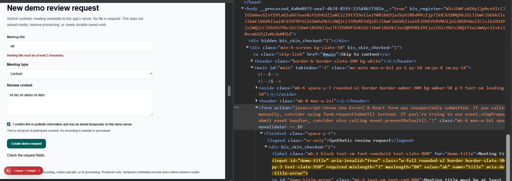

**Hasil nyata:** judul `ab` menghasilkan `Meeting title must be at least 3 characters.` Tipe `Lecture`, context `ini tes ini demo ini teks`, dan konfirmasi tercentang tetap terisi. Elements memperlihatkan `novalidate`, `aria-invalid="true"`, serta rujukan galat judul. Bukti diterima sebagai galat judul setelah bypass validasi native.

#### M02 — Pilihan tipe di luar enum (V02)

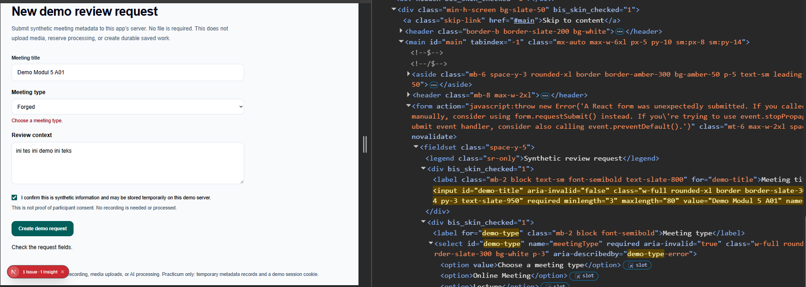

**Hasil nyata:** pilihan `Forged` menghasilkan `Choose a meeting type.` Judul `Demo Modul 5 A01`, context yang valid, dan konfirmasi tetap terisi. Elements memperlihatkan `novalidate` serta `aria-invalid="true"` dan `aria-describedby="demo-type-error"` pada select. Bukti diterima sebagai bypass enum; bukan pengulangan kasus judul pendek.

#### M03 — Konfirmasi tidak dicentang (V03)

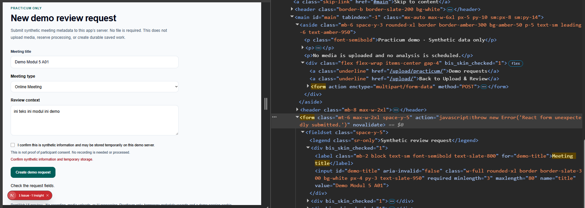

**Hasil nyata:** checkbox kosong menghasilkan `Confirm synthetic information and temporary storage.` Judul valid, tipe `Online Meeting`, dan context `ini teks ini modul ini demo` terlihat bersama atribut `novalidate`. Bukti diterima sebagai kasus bypass konfirmasi. Detail ARIA checkbox tidak terbuka pada gambar ini; penerapannya dirujuk pada kode dan tes.

#### M04 — Context di bawah batas minimum (V05)

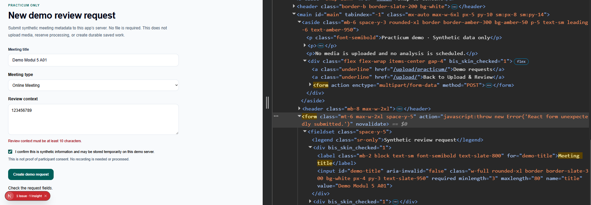

**Hasil nyata:** context `123456789` (9 karakter) menghasilkan `Review context must be at least 10 characters.` Judul valid, tipe `Online Meeting`, konfirmasi tercentang, dan `novalidate` terlihat. Bukti diterima untuk galat kolom context; batas 501 karakter dibuktikan oleh unit test, bukan gambar ini.

#### M06 — Detail request yang berhasil dibuat (V10)

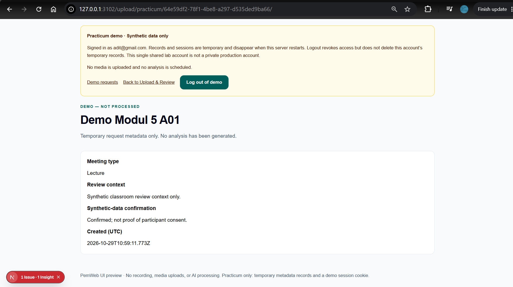

**Hasil nyata:** pada host lokal `127.0.0.1:3102`, halaman detail menampilkan ID pada URL, judul `Demo Modul 5 A01`, tipe `Lecture`, context `Synthetic classroom review context only.`, konfirmasi, timestamp UTC, dan status **Demo — not processed**. Bukti diterima untuk hasil pembuatan record metadata sementara, bukan hasil analisis media.

#### M07 — Record tersedia pada daftar (V10)

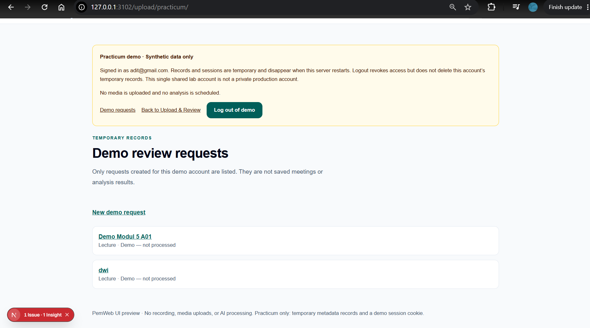

**Hasil nyata:** daftar `/upload/practicum/` pada `127.0.0.1:3102` memuat `Demo Modul 5 A01`. Ada satu entri lain yang sudah tersedia; gambar ini tidak diklaim sebagai daftar yang totalnya hanya satu record. Bukti diterima untuk keterbacaan request baru pada daftar.

#### M05 — Penolakan duplikat tanpa membedakan kapitalisasi (V09)

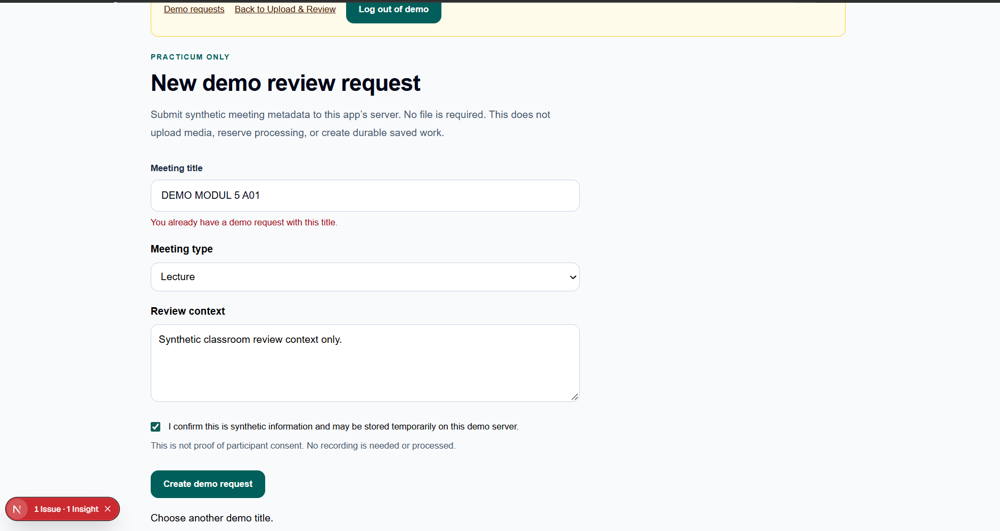

**Hasil nyata:** setelah request pada M06–M07, formulir dengan judul `DEMO MODUL 5 A01` menampilkan `You already have a demo request with this title.` dan `Choose another demo title.` Tipe `Lecture`, context, dan checkbox tetap terisi. Pasangan gambar ini mendukung aturan semantik case-insensitive serta retensi input; jumlah record setelah penolakan diverifikasi oleh tes otomatis, tidak terlihat langsung pada M05.

## 4. Session dan Cookie

Sesi menggunakan ID opaque dari `node:crypto.randomUUID()`. Cookie `private-session-demo` hanya menyimpan ID; pemilik dan waktu kedaluwarsa berada di Map server. Cookie tersebut tetap merupakan rahasia akses yang harus disamarkan. Saat masuk berhasil, sesi lama yang dirujuk cookie dicabut dan ID baru diterbitkan.

| Atribut    | Nilai implementasi          | Alasan / batas                                                                                                        |
| ---------- | --------------------------- | --------------------------------------------------------------------------------------------------------------------- |
| `HttpOnly` | `true`                      | JavaScript halaman tidak dapat membaca cookie melalui `document.cookie`; DevTools tetap dapat melihatnya              |
| `SameSite` | `Lax`                       | Membatasi pengiriman lintas situs dalam sebagian konteks; bukan pengganti otorisasi server                            |
| `Secure`   | `NODE_ENV === "production"` | Aktif pada build produksi; development lokal tidak mengaktifkannya. Jangan mengubah source untuk meloloskan pengujian |
| `Path`     | `/`                         | Cookie tersedia pada rute masuk, keluar, dan practicum                                                                |
| `Max-Age`  | `28800` detik               | Delapan jam; server juga memeriksa `expiresAt`, bukan hanya masa berlaku browser                                      |
| `Domain`   | Tidak ditetapkan            | Cookie terbatas pada host yang menerbitkannya                                                                         |

Potongan aktual opsi cookie:

```ts
return {
  httpOnly: true,
  secure: process.env.NODE_ENV === "production",
  sameSite: "lax" as const,
  path: "/",
  maxAge: SESSION_SECONDS,
};
```

`cookies()` dipanggil dengan `await`. Penulisan cookie berlangsung melalui aksi masuk/keluar, bukan saat render Server Component. Logout mencabut ID pada store dan mengirim cookie kosong dengan `Max-Age=0`. Logout tidak menghapus record milik akun; masuk lagi pada proses server yang sama masih dapat membacanya. Restart proses menghapus semua record dan sesi. Retensi `globalThis` membantu development refresh pada proses yang sama, bukan persistensi disk atau jaminan lintas worker.

| Skenario                                 | Hasil yang diharapkan                                      | Hasil nyata / batas bukti                                                                                                     |
| ---------------------------------------- | ---------------------------------------------------------- | ----------------------------------------------------------------------------------------------------------------------------- |
| Cookie tidak ada                         | Halaman terlindungi menuju sign-in; aksi menolak           | Lulus unit ulang dan browser sebelumnya                                                                                       |
| Cookie palsu tetapi ada                  | Lolos pemeriksaan kehadiran proxy, gagal verifikasi sesi   | Lulus unit/action ulang dan browser sebelumnya; M11–M12 memperlihatkan penolakan aksi dan halaman sign-in dengan cookie palsu |
| Sesi mencapai delapan jam                | `readSession` menolak; aksi tidak membuat record           | Lulus unit ulang menggunakan fake clock, bukan menunggu delapan jam di browser                                                |
| Masuk lagi dengan cookie sesi saat ini   | Sesi diputar; ID sebelumnya ditolak                        | Lulus unit ulang dan browser sebelumnya                                                                                       |
| Logout                                   | ID server dicabut, cookie browser dihapus, menuju Overview | Lulus unit ulang dan browser sebelumnya; M13 memperlihatkan Overview dan tabel cookie kosong                                  |
| Replay cookie lama setelah logout        | Tetap ditolak meskipun cookie dikembalikan                 | Lulus unit ulang dan browser sebelumnya; M14 dilampirkan dengan Value disamarkan dan keterbatasan nama cookie terpotong       |
| ID record milik owner berbeda            | Store tidak mengembalikan record                           | Lulus unit ulang; bukan klaim dua akun UI tersedia                                                                            |
| ID detail salah format / tidak ditemukan | Not found tanpa membocorkan data                           | Browser sebelumnya lulus; halaman juga memeriksa sesi sebelum ID                                                              |

### Evaluasi bukti cookie pada 29 Oktober 2026

Screenshot yang disediakan menggunakan host `127.0.0.1`: M08 pada port 3000 dan M09–M14 pada port 3101. Caption mengikuti alamat yang benar-benar terlihat, bukan menggantinya dengan `localhost`. Rangkaian cookie palsu/logout/replay memakai host yang sama pada gambar; jangan berpindah host di tengah reproduksi karena cookie `localhost` dan `127.0.0.1` berbeda.

| Bukti | Hasil inspeksi                                                                                               | Status                                                 |
| ----- | ------------------------------------------------------------------------------------------------------------ | ------------------------------------------------------ |
| M08   | Nama dan atribut development terbaca; Value telah disamarkan pada revisi                                     | Diterima                                               |
| M09   | Nama dan atribut produksi terbaca; Value telah disamarkan pada revisi                                        | Diterima                                               |
| M10   | Header Set-Cookie terbaca dengan nilai ID ditutup; Max-Age 28800, Secure, HttpOnly dan SameSite lax terlihat | Diterima                                               |
| M11   | Form valid menampilkan penolakan sesi dan cookie berisi string uji `forged`                                  | Diterima                                               |
| M12   | URL sign-in dan cookie palsu `forged` pada host yang sama terlihat                                           | Diterima sebagai hasil skenario manual yang dilaporkan |
| M13   | URL Overview dan tabel Cookies tanpa filter berisi kosong                                                    | Diterima sebagai hasil logout yang dilaporkan          |
| M14   | URL sign-in dan cookie terlihat; Value sudah disamarkan, Name masih terpotong                                | Dilampirkan dengan catatan keterbatasan visual         |

Pemotongan otomatis dengan elipsis pada kolom Value bukan penyamaran penuh. Nilai ID sesi asli harus ditutup dengan bidang solid, termasuk awalan yang masih tampak. String literal `forged` pada M11–M12 adalah input uji buatan, bukan ID sesi asli, sehingga dipertahankan untuk menjelaskan skenario. Gambar asli tidak diubah oleh agen.

#### M08 — Cookie development

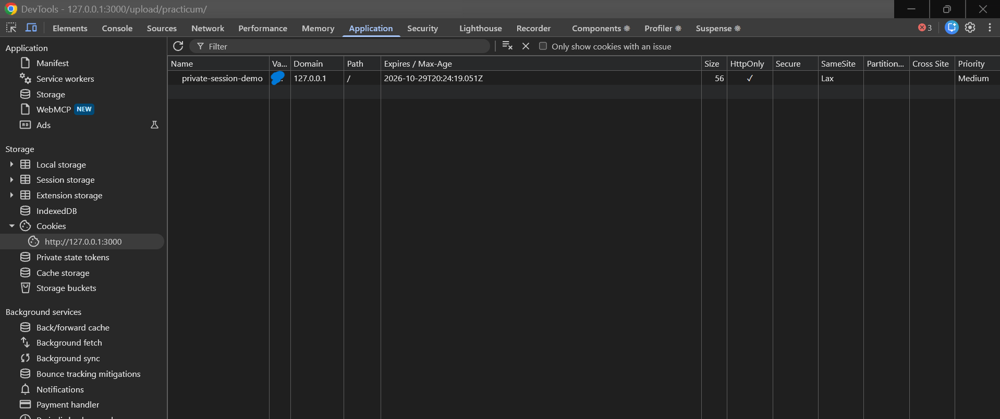

**Hasil nyata:** Pada origin `http://127.0.0.1:3000`, nama `private-session-demo`, Path `/`, expiry, HttpOnly aktif, Secure tidak aktif, dan SameSite Lax terbaca. Value telah ditutup dengan penanda biru pada revisi mahasiswa. Bukti diterima untuk atribut cookie development.

#### M09 — Cookie produksi

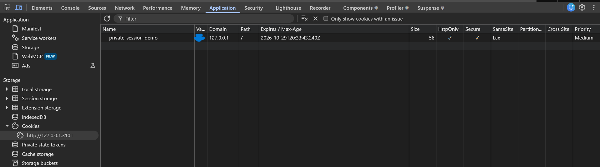

**Hasil nyata:** Pada origin `http://127.0.0.1:3101`, nama `private-session-demo`, Path `/`, expiry, HttpOnly dan Secure aktif, serta SameSite Lax terbaca. Value telah ditutup dengan penanda biru. Bukti diterima untuk atribut cookie produksi dan melengkapi header M10.

#### M10 — Header Set-Cookie produksi

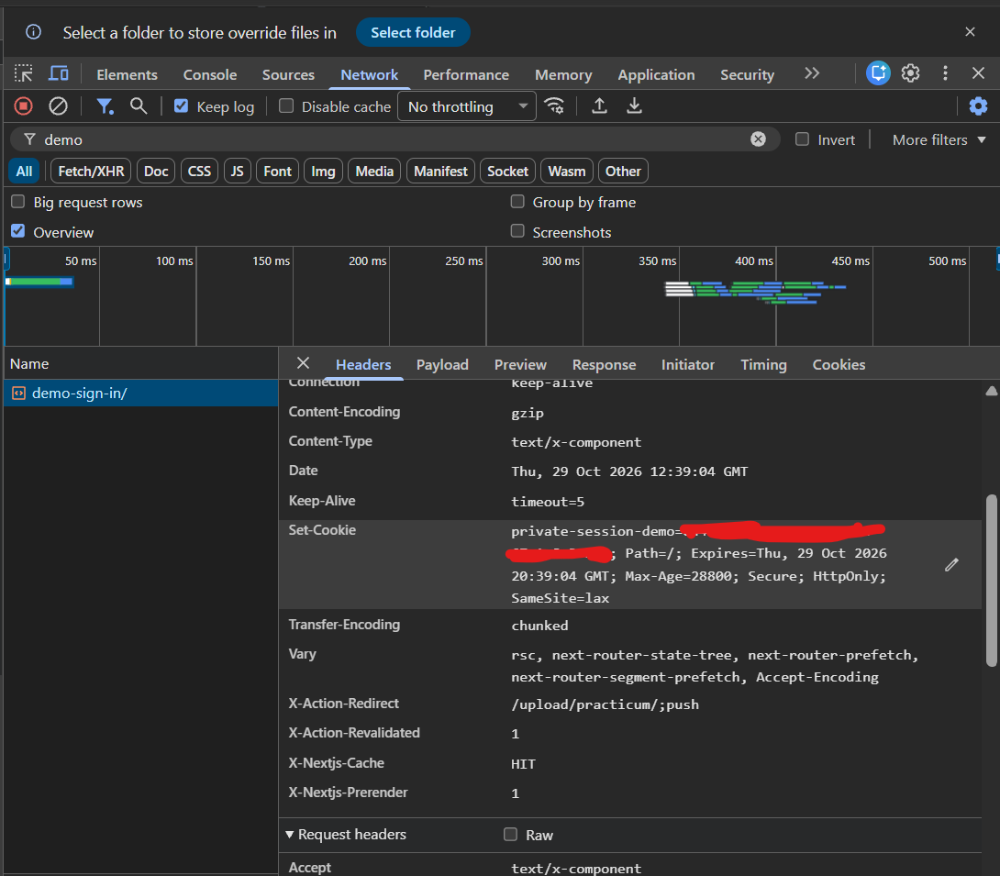

**Hasil nyata:** Network menampilkan respons `demo-sign-in/` dengan header `Set-Cookie`. Nilai ID ditutup, sementara nama `private-session-demo`, Path `/`, Expires, `Max-Age=28800`, `Secure`, `HttpOnly`, dan `SameSite=lax` terbaca. Header `X-Action-Redirect` menunjuk `/upload/practicum/;push`. Bukti diterima untuk atribut cookie yang diterbitkan server; bagian General/metode request tidak terlihat pada crop ini, sehingga tidak diklaim diverifikasi secara visual.

#### M11 — Aksi menolak cookie palsu (V11)

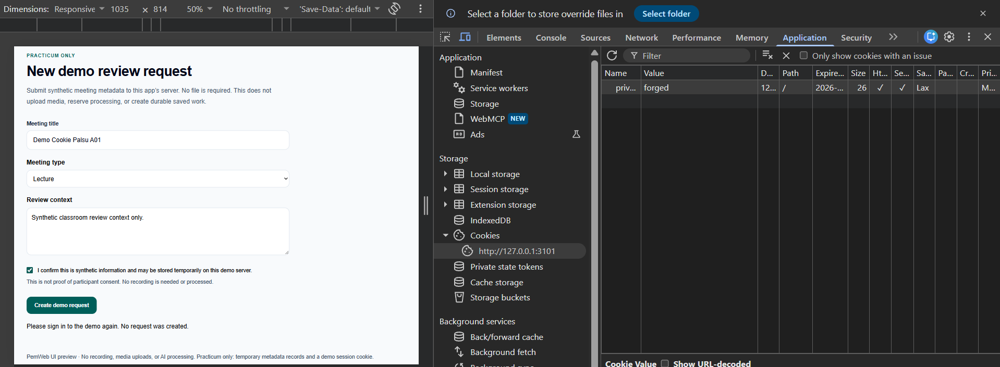

**Hasil nyata:** judul `Demo Cookie Palsu A01`, tipe `Lecture`, context valid dan konfirmasi tercentang masih terlihat. Application menunjukkan nilai uji `forged` pada origin `http://127.0.0.1:3101`; aplikasi menampilkan `Please sign in to the demo again. No request was created.` Bukti diterima untuk penolakan aksi akibat sesi tidak sah.

#### M12 — Halaman terlindungi kembali ke sign-in

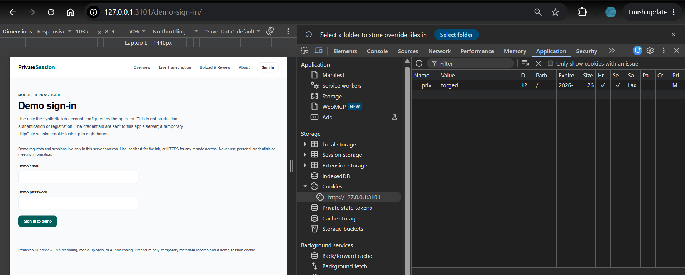

**Hasil nyata:** setelah langkah membuka daftar terlindungi dalam skenario manual, URL akhir adalah `127.0.0.1:3101/demo-sign-in/`, sementara cookie uji `forged` masih terlihat. Bukti diterima sebagai keadaan akhir skenario yang dilaporkan mahasiswa, didukung M11 dan tes otomatis. Gambar tunggal tidak merekam navigasi awal atau rantai redirect jaringan.

#### M13 — Logout menghapus cookie browser

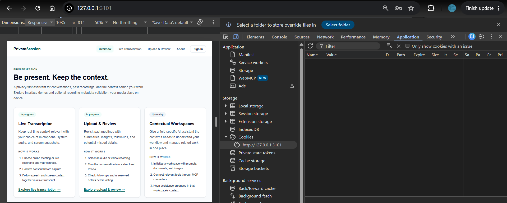

**Hasil nyata:** pada akhir langkah logout, browser berada di Overview `127.0.0.1:3101`, dan tabel Cookies origin yang sama kosong tanpa teks filter maupun filter issue aktif. Bukti diterima untuk keadaan akhir logout. Pencabutan ID dalam store server dibuktikan terpisah oleh tes; tabel kosong saja hanya menunjukkan penghapusan cookie browser.

#### M14 — Keadaan akhir uji replay setelah logout

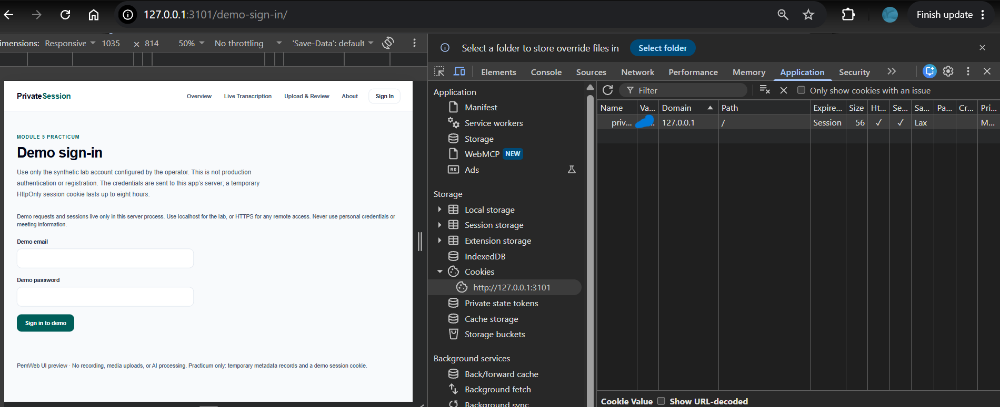

**Hasil yang terlihat:** browser berada di `127.0.0.1:3101/demo-sign-in/`, sementara tabel Cookies pada origin yang sama kembali memuat sebuah cookie dengan Path `/`, HttpOnly dan Secure aktif, serta SameSite Lax. Value telah disamarkan. Gambar dipertahankan sesuai keputusan mahasiswa.

**Batas bukti:** kolom Name hanya menampilkan `priv...`, sehingga nama lengkap `private-session-demo` tidak dapat diverifikasi dari gambar ini saja. Mahasiswa menyediakan gambar sebagai hasil skenario replay cookie lama setelah logout; gambar statis tidak membuktikan kesamaan ID dengan sesi sebelum logout atau tidak adanya restart/login di antaranya. Interpretasi replay didukung konteks skenario manual, M13, dan tes otomatis yang dicatat sebelumnya, bukan semata-mata gambar ini. Kolom Expires `Session` menunjukkan cookie buatan berlaku selama sesi browser; ini tidak meniadakan pemeriksaan expiry server.

## 5. Keputusan Teknis

- **Bentuk dan semantik dipisahkan.** Zod memastikan data memiliki tipe/rentang yang benar; store memeriksa relasi terhadap data yang sudah ada. Keunikan judul bergantung pada pemilik dan record server, sehingga tidak dapat dipercayakan ke pilihan UI atau validasi browser.
- **Sesi server dengan ID opaque.** Browser membawa pengenal acak, bukan klaim identitas yang dianggap sah tanpa lookup. Pencabutan logout/rotasi dapat berlaku langsung dengan menghapus ID server; token mandiri memerlukan strategi tambahan untuk pencabutan sebelum kedaluwarsa. Kekurangannya adalah kebutuhan state bersama bila aplikasi kelak memiliki beberapa instance.
- **Batas proxy.** [proxy.ts](../../proxy.ts) hanya memeriksa kehadiran cookie untuk rute `/upload/practicum/:path*`. Cookie palsu tetap dapat melewatinya. Setiap halaman dan mutasi memverifikasi sesi secara independen, termasuk expiry dan pemilik, sehingga proxy bukan otorisasi.
- **Penyimpanan sementara dipilih untuk practicum.** Map server menyimpan record metadata dan sesi dalam satu proses. Tidak ada database, enkripsi record demo, atau akun produksi. Pemisahan modul, komponen, rute, dan tes practicum memungkinkan penghapusan kemudian melalui pekerjaan terpisah; bukti revisi yang dikumpulkan perlu dipertahankan terlebih dahulu.
- **Batas autentikasi lab.** Satu akun sintetis ditentukan melalui environment yang diabaikan Git. Pembandingan credential memakai digest SHA-256 dengan `timingSafeEqual`; ini bukan sistem penyimpanan password produksi atau pengganti password hashing khusus. Semua pengguna akun lab yang sama berbagi owner dan record sementara. Tidak ada klaim isolasi antarpengguna nyata.
- **Kesesuaian produk.** Demo mengajarkan formulir, sesi, dan mutasi tanpa mengubah pemilihan rekaman menjadi unggahan. Alur publik validasi metadata dan demo enkripsi tetap terpisah. Native capture, pemrosesan media, dan persistensi produk belum diimplementasikan oleh practicum ini.

## 6. Kendala dan Penyelesaian

| Kendala yang ditemukan                                                     | Penyelesaian / status                                                                                                                                                                                   |
| -------------------------------------------------------------------------- | ------------------------------------------------------------------------------------------------------------------------------------------------------------------------------------------------------- |
| Select dan checkbox ter-reset otomatis setelah aksi gagal                  | Nilai memakai state terkontrol dan reset form dicegah. Retensi diuji kembali pada penolakan/retry                                                                                                       |
| Penanganan error klien dapat menangkap kontrol redirect Next.js            | Hook memanggil `unstable_rethrow` sebelum mengubah error jaringan menjadi pesan retry; redirect server tetap di luar `try` mutasi                                                                       |
| `Set-Cookie` tidak muncul pada akses header singkat di tes browser         | Tes memakai `response.allHeaders()` dan hanya menilai atribut, tanpa mencetak nilai cookie                                                                                                              |
| Assertion logout terlalu longgar terhadap URL berakhiran `/`               | Tes menunggu URL Overview yang tepat, kemudian memeriksa cookie hilang dan replay ditolak                                                                                                               |
| Port default sudah dipakai saat pengujian implementasi                     | Server pengguna dibiarkan berjalan; tes memakai port 3101/3102. Langkah manual harus memilih port kosong                                                                                                |
| Peringatan keamanan Next.js menghentikan sebagian startup/build sebelumnya | Run berikutnya tercatat berhasil, tetapi retry bukan perbaikan kerentanan. Upgrade tidak dilakukan; masalah framework tetap menjadi blocker deployment terpisah                                         |
| Nama cookie pada bukti replay terpotong                                    | M14 tetap dipertahankan; Value disamarkan dan keterbatasan nama terpotong dijelaskan pada caption. Semua 14 gambar dilampirkan. Tidak ada gambar yang diedit atau dibuat oleh agen |


## 7. Catatan Pemanfaatan AI

**Alat:** OpenAI Codex. AI digunakan untuk implementasi practicum, pengujian, dan penyusunan dokumentasi teknis ini; tidak digunakan untuk mengerjakan tes individu bagian G. Riwayat lengkap dipertahankan di [AI_LOG.md](../../AI_LOG.md).

| Tanggal / pekerjaan                     | Perintah utama (ringkasan)                                                                                                                                      | Bagian keluaran yang digunakan                                                      | Cara verifikasi                                                                                                                                             |
| --------------------------------------- | --------------------------------------------------------------------------------------------------------------------------------------------------------------- | ----------------------------------------------------------------------------------- | ----------------------------------------------------------------------------------------------------------------------------------------------------------- |
| 23 Oktober 2026, validasi metadata awal | Terapkan Zod dan Server Action pada Upload & Review, kirim hanya filename/size                                                                                  | Skema dan aksi metadata publik; dijadikan konteks pembeda dari form practicum       | Hasil pengujian bertanggal di EVALUASI; kode alur publik tidak diklaim sebagai pembuatan record                                                             |
| 27 Oktober 2026, implementasi practicum | Lengkapi Module 5 lewat demo terpisah dengan empat kolom, sesi/cookie, penyimpanan sementara dan pengujian; jangan buat dokumen teknis atau screenshot dulu     | Rute/form demo, schema, store, session, proxy, aksi, pengujian dan catatan evaluasi | Check 89 unit, build, 96 browser produksi dan satu development tercatat pada pekerjaan implementasi; batas produksi/manual dicatat                          |
| 27 Oktober 2026, penyusunan dokumen     | Susun `docs/praktikum/modul-05.md` mengikuti bagian H; gunakan Bahasa Indonesia dan beri penanda serta langkah screenshot yang dilakukan sendiri oleh mahasiswa | Dokumen ini, pemetaan kode, tabel uji dan panduan M01–M14                           | Bagian H dibaca kembali; schema/action/session/store/form/tests dicocokkan; 28 unit practicum dijalankan ulang dan lulus; tautan lokal dan format diperiksa |

