# Dokumen Teknis Modul 6 — PostgreSQL dan Prisma ORM

Nama/NIM: Erlangga Aditya Permana / 105224038  
Repositori: <https://github.com/xvasgit/PrivateSession>  
Branch kerja saat penyusunan: `praktikum/modul-06`  

Objek implementasi adalah **meeting database lab** PrivateSession: metadata sesi rapat dan segmen transkrip sintetis yang dimasukkan manual, bukan rekaman yang ditranskripsi otomatis. Akses melalui Upload & Review → meeting database lab; setelah demo sign-in, pilih tautan Module 6 pada daftar practicum.

Lab memakai PostgreSQL 18, Prisma ORM 7, Next.js App Router, TypeScript, dan Zod 4. Satu akun demo bersama mengakses semua meeting; belum ada kolom pemilik atau isolasi per pengguna. Record database bertahan setelah restart, sedangkan sesi masuk masih menggunakan penyimpanan proses sementara dari Modul 5. Tidak ada unggahan media, perekaman, pemrosesan AI, atau autentikasi produksi.

## 1. Rancangan Data

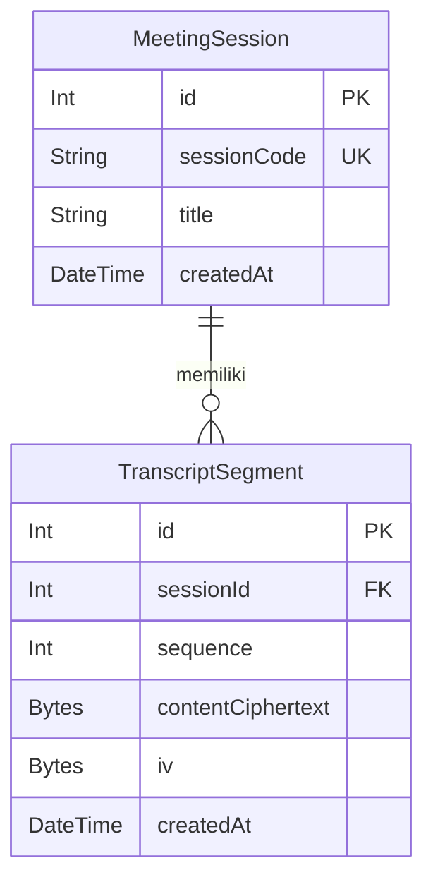

Satu `MeetingSession` dapat mempunyai **0..N** segmen. Setiap `TranscriptSegment` wajib mempunyai tepat satu parent. `segments` dan `session` pada Prisma adalah field relasi, bukan kolom tambahan pada PostgreSQL.

| Elemen         | Aturan dan alasan                                                                                                                                                                                    |
| -------------- | ---------------------------------------------------------------------------------------------------------------------------------------------------------------------------------------------------- |
| PK kedua tabel | `id` integer auto-increment; identitas internal tetap walaupun judul/kode sesi berubah.                                                                                                              |
| Kode sesi      | `sessionCode @unique`; kode tidak boleh duplikat. Pada lab ini perbandingan kode case-sensitive.                                                                                                     |
| Urutan segmen  | `@@unique([sessionId, sequence])`; nomor urut unik dalam satu sesi, tetapi boleh sama pada sesi berbeda. Diagram menunjukkan kolomnya; constraint uniknya merupakan pasangan, bukan sequence global. |
| FK             | `sessionId` wajib merujuk parent yang ada; semua kolom fisik pada skema bersifat NOT NULL.                                                                                                           |
| Penghapusan    | `onDelete: Restrict` mencegah penghapusan parent yang masih memiliki segmen. Penghapusan seluruh isi membutuhkan pilihan eksplisit dan transaksi.                                                    |
| Waktu          | `createdAt` menggunakan `now()`, dipetakan menjadi `TIMESTAMP(3)`. Ini waktu pembuatan, bukan waktu pembaruan.                                                                                       |

Aturan panjang teks dan integer positif diterapkan pada validasi aplikasi; migrasi tidak menambahkan CHECK constraint untuk batas tersebut. PK, FK, NOT NULL, dan keunikan tetap ditegakkan oleh database.

**Penyimpanan terenkripsi:** `contentCiphertext` berisi ciphertext AES-256-GCM beserta tag 16 byte, sedangkan `iv` berisi nonce acak 12 byte. Keduanya BYTEA. Metadata seperti judul, kode, sequence, ID, dan timestamp tetap plaintext. Tidak ada kolom plaintext `content` ataupun kolom kunci.

[Adapter transkrip](../../lib/crypto/transcript-encryption.ts) memakai helper AES-GCM yang sudah ada. Konteks `transcript-segment:v1:<sessionId>:<sequence>` dibungkus namespace AAD helper `meeting-session:v1:`. Perubahan teks memakai IV baru; parent dan sequence segmen lama tidak dapat diubah lewat form. Kunci lab persisten 32 byte diimpor melalui [loader server-only](../../lib/crypto/transcript-encryption.server.ts). Nilainya tidak ditampilkan atau disimpan dalam tabel/Git.

Ini **enkripsi at rest**, bukan end-to-end encryption: server menerima teks form dan mendekripsinya untuk halaman detail yang sudah terautentikasi. Operator yang memiliki kunci tetap dapat membaca data; kehilangan kunci membuat ciphertext lama tidak terbaca. Rotasi kunci, kepemilikan multi-user, dan vault produksi belum diimplementasikan.

## 2. Skema dan Migrasi

Isi [prisma/schema.prisma](../../prisma/schema.prisma):

```prisma
generator client {
  provider = "prisma-client"
  output   = "../generated/prisma"
}

datasource db {
  provider = "postgresql"
}

model MeetingSession {
  id          Int                 @id @default(autoincrement())
  sessionCode String              @unique
  title       String
  createdAt   DateTime            @default(now()) @db.Timestamp(3)
  segments    TranscriptSegment[]
}

model TranscriptSegment {
  id                Int            @id @default(autoincrement())
  sessionId         Int
  sequence          Int
  contentCiphertext Bytes
  iv                Bytes
  createdAt         DateTime       @default(now()) @db.Timestamp(3)
  session           MeetingSession @relation(fields: [sessionId], references: [id], onDelete: Restrict)

  @@unique([sessionId, sequence])
}
```

URL koneksi berada di [prisma.config.ts](../../prisma.config.ts), bukan di blok datasource skema. Variabel lokal yang digunakan adalah `DATABASE_URL`, `SHADOW_DATABASE_URL`, dan `DATA_ENCRYPTION_KEY`; tidak ada nilai rahasia dalam dokumen. Database aplikasi `privatesession_dev` berbeda dari `privatesession_shadow`, yang khusus menjadi scratch database migrasi. Koneksi dibatasi ke loopback.

Struktur migrasi:

```text
prisma/migrations/
├── migration_lock.toml
└── 20261102152914_init_meeting_transcripts/
    └── migration.sql
```

Potongan [migration.sql](../../prisma/migrations/20261102152914_init_meeting_transcripts/migration.sql) berikut mempertahankan definisi aktual:

```sql
CREATE TABLE "MeetingSession" (
    "id" SERIAL NOT NULL,
    "sessionCode" TEXT NOT NULL,
    "title" TEXT NOT NULL,
    "createdAt" TIMESTAMP(3) NOT NULL DEFAULT CURRENT_TIMESTAMP,
    CONSTRAINT "MeetingSession_pkey" PRIMARY KEY ("id")
);

CREATE TABLE "TranscriptSegment" (
    "id" SERIAL NOT NULL,
    "sessionId" INTEGER NOT NULL,
    "sequence" INTEGER NOT NULL,
    "contentCiphertext" BYTEA NOT NULL,
    "iv" BYTEA NOT NULL,
    "createdAt" TIMESTAMP(3) NOT NULL DEFAULT CURRENT_TIMESTAMP,
    CONSTRAINT "TranscriptSegment_pkey" PRIMARY KEY ("id")
);

CREATE UNIQUE INDEX "MeetingSession_sessionCode_key"
ON "MeetingSession"("sessionCode");

CREATE UNIQUE INDEX "TranscriptSegment_sessionId_sequence_key"
ON "TranscriptSegment"("sessionId", "sequence");

ALTER TABLE "TranscriptSegment"
ADD CONSTRAINT "TranscriptSegment_sessionId_fkey"
FOREIGN KEY ("sessionId") REFERENCES "MeetingSession"("id")
ON DELETE RESTRICT ON UPDATE CASCADE;
```

Perintah reproduksi dari root aplikasi: `npm run db:generate`, `npm run db:migrate`, dan `npm run db:status`. Tidak diperlukan migrasi tambahan untuk UI CRUD ini.

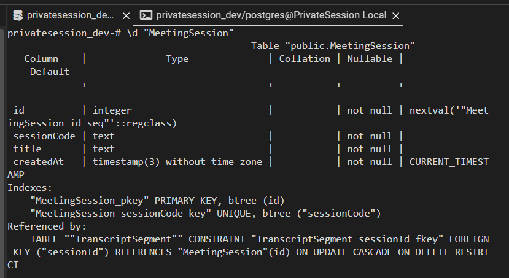

**Gambar 01.** Hasil `\d "MeetingSession"` memperlihatkan PK, unique sessionCode, NOT NULL, default waktu, serta referensi FK dengan DELETE RESTRICT. Baris panjang membungkus, tetapi informasi constraint tetap terbaca.

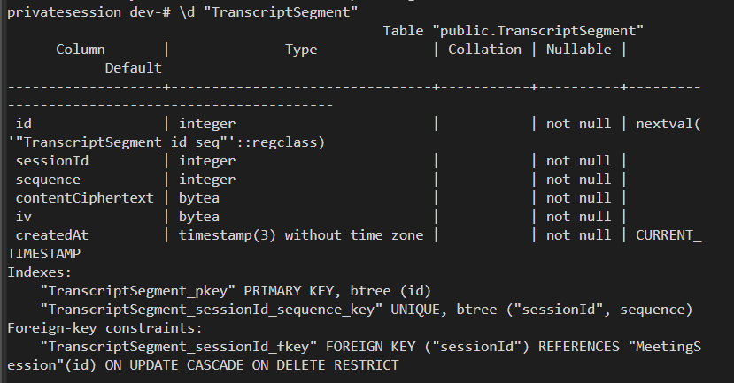

**Gambar 02.** Hasil `\d "TranscriptSegment"` menunjukkan BYTEA ciphertext/IV, unique gabungan parent–sequence, serta foreign key. Bukti ini menunjukkan tipe dan struktur kolom, bukan dump isi ciphertext sebuah record.

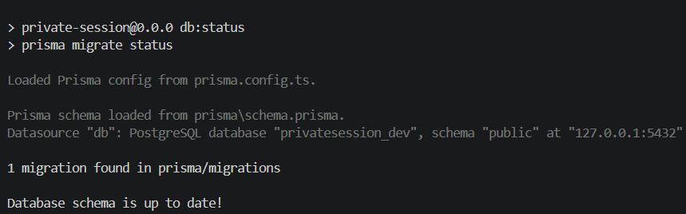

**Gambar 03.** `prisma migrate status` menemukan satu migrasi dan menyatakan database `privatesession_dev` up to date.

## 3. Seed dan Prisma Client

[Seed](../../prisma/seed.ts) memakai [fixture sintetis](../../prisma/data-awal.ts): dua sesi dengan total tiga segmen. Sesi di-upsert berdasarkan sessionCode dan segmen berdasarkan pasangan sessionId–sequence. Cabang `update: {}` mempertahankan record yang sudah ada; cabang create mengisi record yang belum tersedia.

Seed menjalankan upsert dalam transaksi dan mengautentikasi setiap segmen tersimpan dengan dekripsi. Walaupun kandidat ciphertext baru dihitung saat pemanggilan ulang, cabang update kosong tidak menimpa ciphertext/IV lama. Seed tidak memperbaiki isi record lama yang sudah diubah pengguna; verifier terpisah membandingkan hasil dekripsi dengan fixture yang diharapkan.

[Client aplikasi](../../lib/prisma.ts) memakai `import "server-only"` dan inisialisasi lazy yang digunakan ulang selama proses berjalan. Seed **tidak mengimpor client tersebut** karena berjalan sebagai CLI di luar runtime Next.js. Seed membuat PrismaClient sendiri dengan PrismaPg dan menutup koneksi melalui `$disconnect()` pada finally. [Loader environment](../../scripts/load-lab-env.ts) membaca konfigurasi lokal secara eksplisit tanpa mencetak rahasia; environment proses mempunyai prioritas.

Urutan yang benar-benar terlihat pada screenshot:

```powershell
npm run db:seed
npm run db:verify -- --seed-twice
npm run db:seed
```

Script npm `db:seed` menjalankan `prisma db seed`, yaitu operasi Prisma yang juga dapat dipanggil melalui `npx prisma db seed`. Verifikasi di tengah menjalankan seed dua kali lagi secara internal; rangkaian ini berisi dua pemanggilan manual dan dua pengulangan internal.

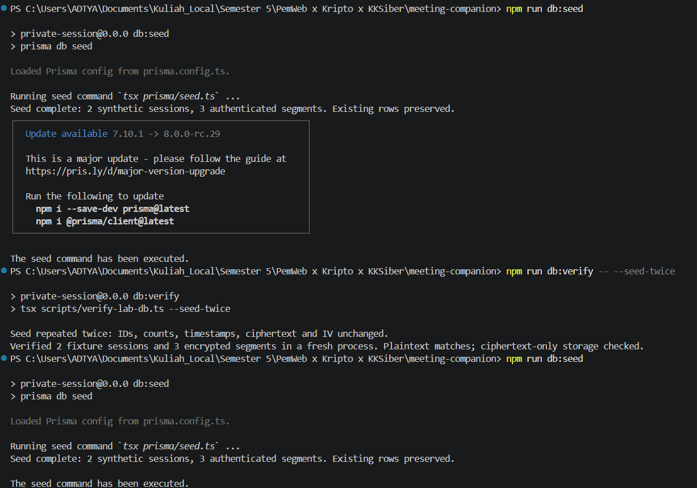

**Gambar 04.** Kedua pemanggilan manual berhasil dengan keluaran `2 synthetic sessions, 3 authenticated segments. Existing rows preserved.` Angka tersebut menghitung fixture yang diproses, bukan seluruh record database. Pemberitahuan versi Prisma bukan kegagalan seed dan tidak berarti upgrade telah dilakukan.

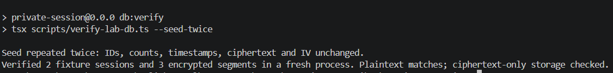

**Gambar 05.** [Verifier](../../scripts/verify-lab-db.ts) membandingkan snapshot sebelum dan setelah masing-masing pengulangan: ID, jumlah, timestamp, ciphertext, dan IV tidak berubah. Pada proses verifier baru, tiga segmen didekripsi dan cocok dengan fixture. Pemeriksaan bytes tidak menemukan plaintext fixture dalam ciphertext. Ini bukti pengulangan pada saat run tersebut, bukan bukti database tidak pernah berubah setelahnya.

## 4. Operasi CRUD

[Server Action](../../app/meetings/actions.ts), [repository](../../lib/meetings/repository.ts), dan [pemetaan galat](../../lib/meetings/errors.ts) membagi validasi/authentication, operasi database, dan pesan form.

| Entitas           | Aksi / halaman                           | Metode Prisma                                              | Galat / penanganan                                                                     |
| ----------------- | ---------------------------------------- | ---------------------------------------------------------- | -------------------------------------------------------------------------------------- |
| MeetingSession    | Create, `/meetings/new/`                 | `create`                                                   | P2002 kode sudah digunakan; Zod menolak input salah.                                   |
| MeetingSession    | Read, `/meetings/` dan `/meetings/[id]/` | `findMany`, `findUnique`, include segments                 | ID invalid/tidak ditemukan → not-found; gangguan database → pesan aman.                |
| MeetingSession    | Update, `/meetings/[id]/edit/`           | `update`                                                   | P2002 kode duplikat; P2025 record sudah dihapus.                                       |
| MeetingSession    | Delete empty meeting, halaman detail     | `delete`                                                   | P2003 jika masih memiliki child; P2025 jika stale.                                     |
| TranscriptSegment | Create, Add a segment pada detail        | Parent `findUniqueOrThrow`, child `create`                 | P2002 sequence duplikat; parent tidak tersedia → P2025, FK tetap menolak orphan.       |
| TranscriptSegment | Read, daftar segmen pada detail          | Parent `findUnique` dengan include dan `orderBy: sequence` | Kegagalan autentikasi/dekripsi → pesan aman, tanpa plaintext pengganti.                |
| TranscriptSegment | Update, Edit segment pada detail         | `findUniqueOrThrow`, `update`                              | P2025 jika ID/parent tidak cocok atau record tidak ada; enkripsi ulang dengan IV baru. |
| TranscriptSegment | Delete segment pada detail               | `delete` dengan id dan sessionId                           | P2025 jika record sudah tidak tersedia atau parent tidak cocok.                        |
| Keduanya          | Delete session and all segments          | `$transaction`, child `deleteMany`, parent `delete`        | Konfirmasi wajib; kegagalan membatalkan transaksi.                                     |

Alur mutasi:

```text
Form → session server → safeParse Zod → pemeriksaan database yang relevan
     → enkripsi/mutasi → revalidatePath("/meetings", "layout")
     → redirect di luar try/catch mutasi
```

Proxy hanya memeriksa keberadaan cookie. Setiap halaman terlindungi dan action tetap memvalidasi sesi server. Form memakai useActionState, pesan field terkait melalui ARIA, status pending, tombol disabled, serta pencegahan reset otomatis agar input bertahan setelah penolakan. Kegagalan jaringan dapat dicoba ulang. Error database mentah dan nilai input tidak dicetak ke log.

[Skema Zod](../../lib/meetings/schema.ts) memvalidasi sessionCode trim 1–64 karakter, title trim 3–80, integer positif maksimal 2147483647, serta content nonblank maksimal 10.000 karakter tanpa mengubah teks aslinya. String integer harus berbentuk desimal positif kanonik; nilai kosong/pecahan/negatif ditolak. Bulk delete mensyaratkan confirmation `"on"`. Validasi Zod otoritatif diuji melalui [unit/direct-action tests](../../tests/database/meetings.test.ts) dan [browser tests](../../tests/e2e/meetings.spec.ts); screenshot bypass validasi terpisah sengaja tidak disertakan.

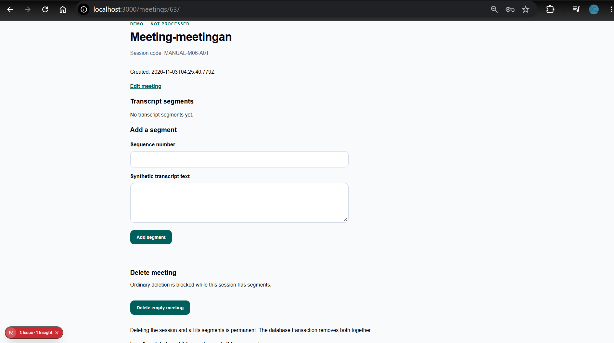

**Gambar 06.** Meeting ID 63, judul “Meeting-meetingan”, kode MANUAL-M06-A01, timestamp pembuatan, dan keadaan tanpa segmen.

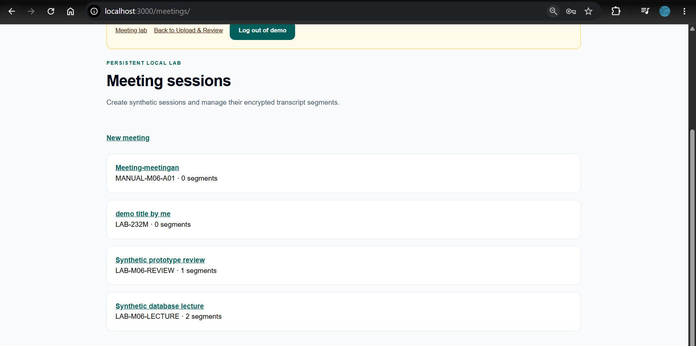

**Gambar 07.** Meeting tersebut muncul pada daftar dengan 0 segments, bersama record lab lain.

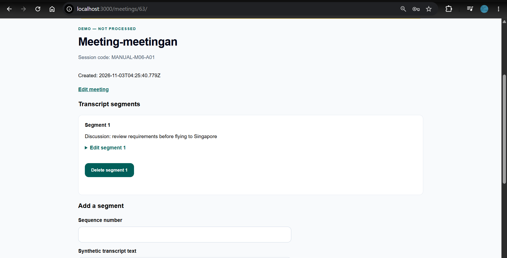

**Gambar 08.** Pada ID 63, Segment 1 menampilkan teks “Discussion: review requirements before flying to Singapore”. Halaman menampilkan hasil dekripsi, bukan bytes database.

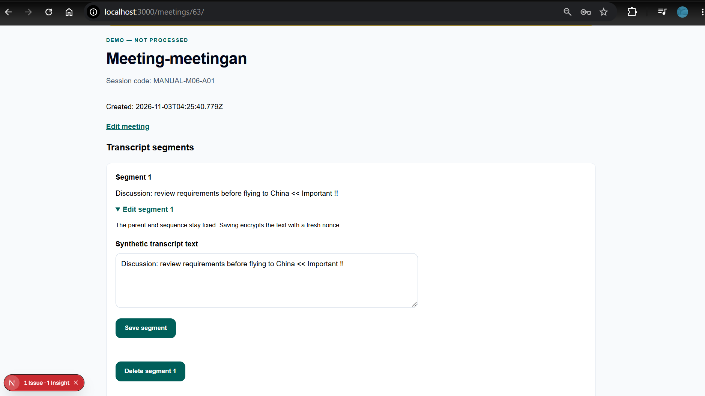

**Gambar 09.** Segment 1 pada ID yang sama menampilkan perubahan tujuan menjadi “China << Important !!”, baik pada teks detail maupun form edit.

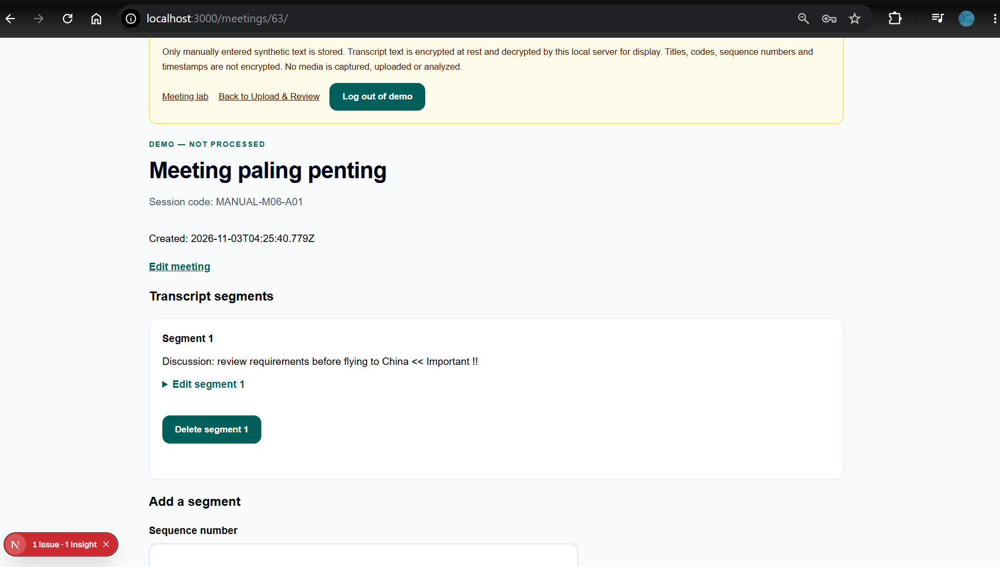

**Gambar 10.** Judul berubah menjadi “Meeting paling penting”; ID 63, kode MANUAL-M06-A01, dan timestamp pembuatan tetap. Gambar ini membuktikan perubahan judul, bukan perubahan kode.

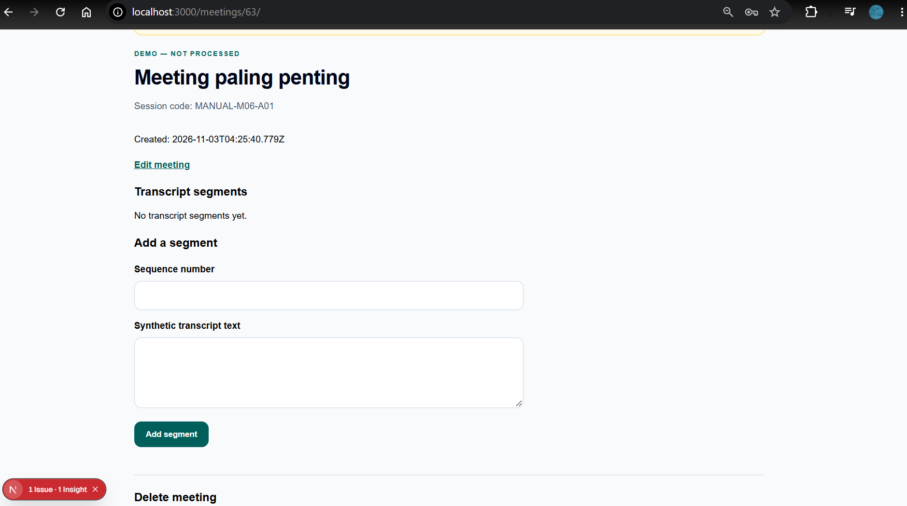

**Gambar 11.** Meeting ID 63 masih tersedia, tetapi tampil “No transcript segments yet.” Semua segmen pada tampilan ini sudah kosong; tidak diklaim bahwa Segment 1 masih tersisa.

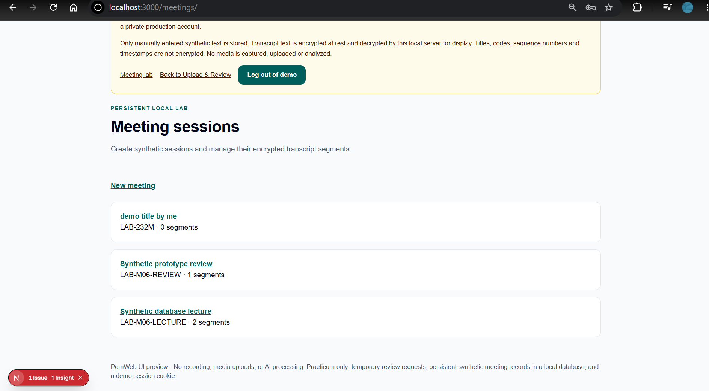

**Gambar 12.** Meeting MANUAL-M06-A01 tidak lagi terlihat pada daftar, sedangkan record lain tetap ditampilkan. Dikaitkan dengan keadaan kosong gambar 11 dan langkah penghapusan; screenshot daftar saja tidak memperlihatkan eksekusi SQL.

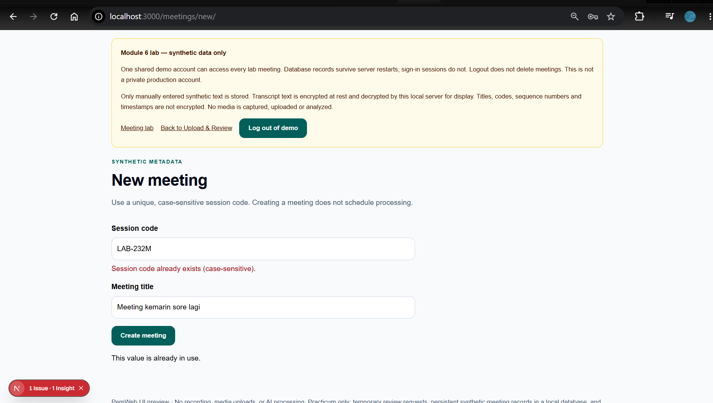

**Gambar 13.** Pembuatan dengan kode LAB-232M ditolak: “Session code already exists (case-sensitive).” Judul “Meeting kemarin sore lagi” masih terisi. Pesan UI dipetakan dari P2002; kode internal tidak ditampilkan ke pengguna.

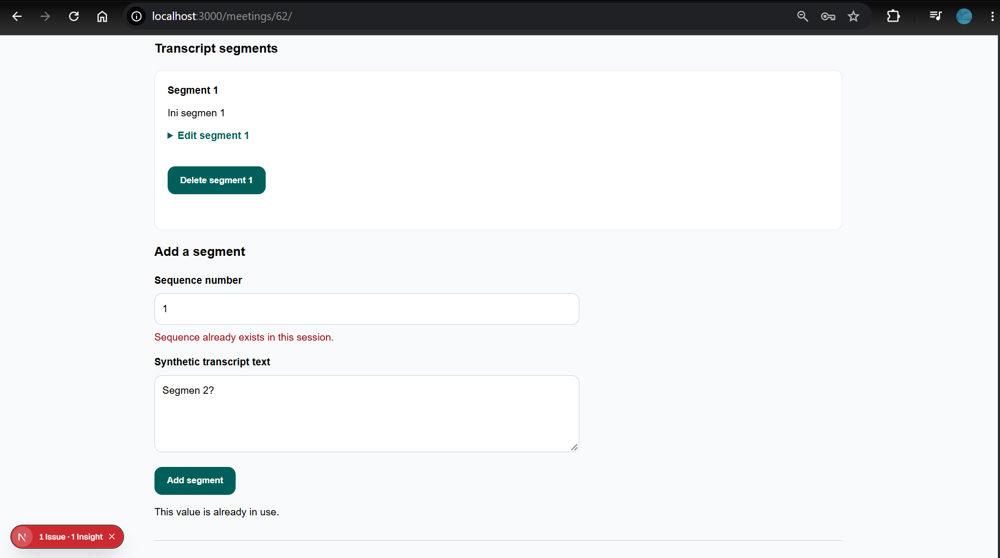

**Gambar 14.** Pada meeting ID 62, Segment 1 sudah ada. Pengiriman sequence 1 lagi ditolak dengan “Sequence already exists in this session.” Input “Segmen 2?” tetap terisi.

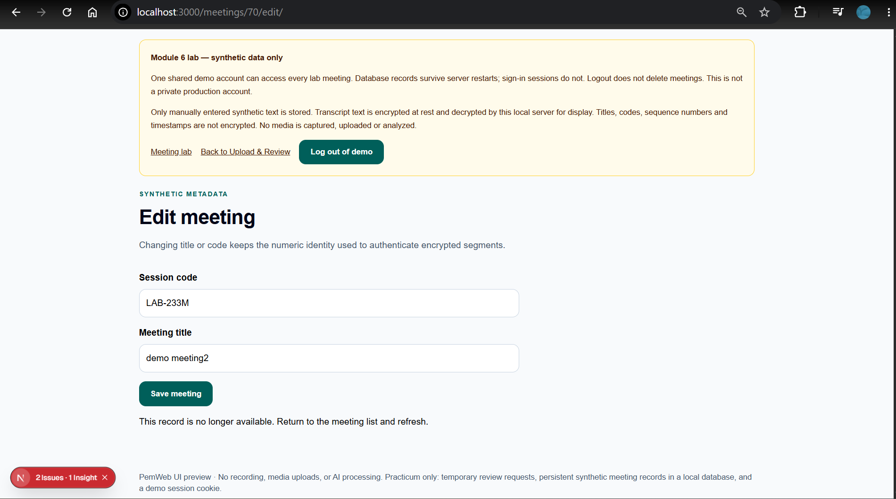

**Gambar 15.** Form edit ID 70 menampilkan “This record is no longer available. Return to the meeting list and refresh.” Kode LAB-233M dan judul “demo meeting2” tetap terisi. Bukti pengganti ini sesuai skenario submit form lama setelah record dihapus; berbeda dari halaman not-found pada screenshot sebelumnya.

## 5. Transaksi dan Rollback

Penghapusan biasa memanggil `meetingSession.delete` tanpa transaksi multi-operasi eksplisit. Jika child masih ada, FK RESTRICT menghasilkan P2003. Ini bukan berarti PostgreSQL bekerja tanpa transaksi internal; yang tidak digunakan adalah transaksi aplikasi untuk menghapus child dan parent sebagai satu unit.

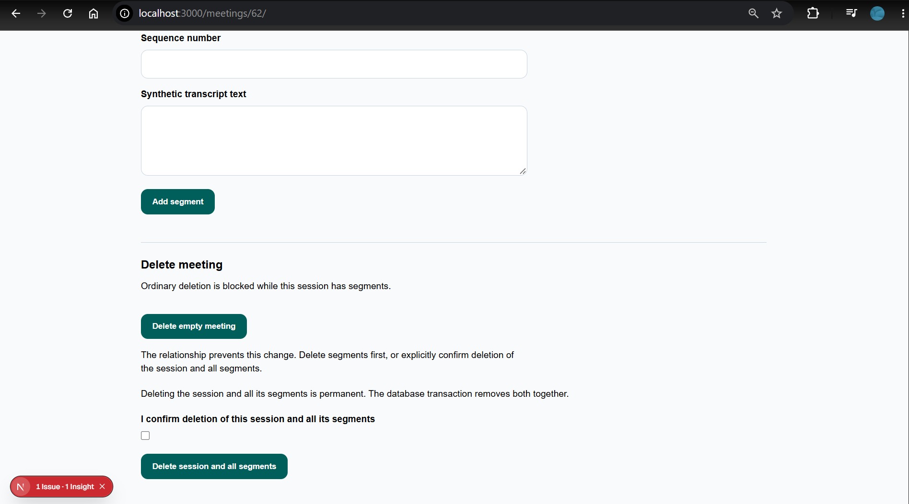

**Gambar 16.** Pada ID 62, Delete empty meeting menghasilkan pesan “The relationship prevents this change…”. Bukti segmen pada parent yang sama tersedia di gambar 14.

Pilihan penghapusan seluruh sesi menggunakan fungsi repository berikut:

```typescript
export async function deleteMeetingWithSegments(db: PrismaClient, id: number) {
  return db.$transaction(async (tx) => {
    await tx.transcriptSegment.deleteMany({ where: { sessionId: id } });
    return tx.meetingSession.delete({ where: { id } });
  });
}
```

Transaksi interaktif dipilih agar urutan child → parent jelas dan semua perubahan hanya berhasil bersama. RESTRICT tetap dipertahankan sebagai perlindungan database, bukan diganti cascade otomatis. Jika salah satu langkah gagal, perubahan dalam transaksi dibatalkan.

[Script pengujian database](../../scripts/test-meeting-db.ts) menguji rollback dengan snapshot sebelum transaksi, menghapus child, memastikan child berjumlah nol di dalam transaksi, lalu sengaja melempar `Intentional test-only rollback` sebelum penghapusan parent. Sesudah penolakan, `assert.deepEqual(after, before)` membandingkan seluruh snapshot, termasuk ID, timestamp, ciphertext, dan IV. Tidak ada tombol atau action publik untuk memicu kegagalan ini.

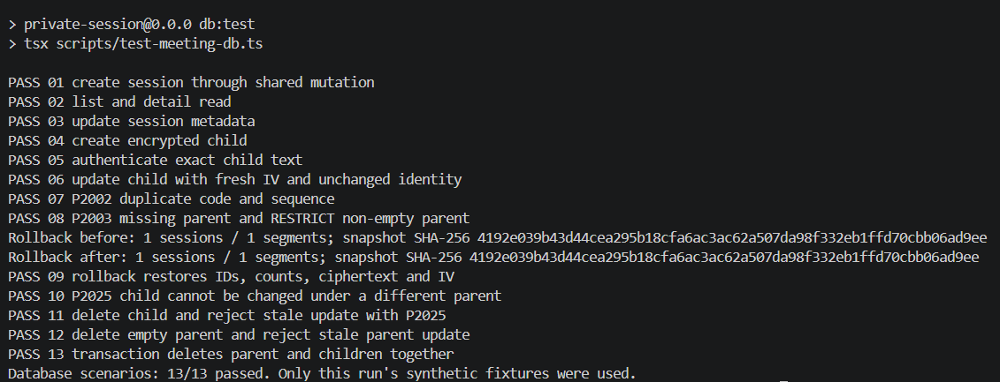

**Gambar 17.** Sebelum dan sesudah rollback terdapat 1 session / 1 segment dengan fingerprint SHA-256 identik. PASS 09 menyatakan snapshot dipulihkan; seluruh PASS 01–13 dan ringkasan `13/13 passed` juga terlihat. Hash berfungsi sebagai checksum bukti, bukan enkripsi dan bukan kunci. Nilai hash antar-run dapat berbeda karena fixture dibuat ulang secara unik; yang dibandingkan adalah sebelum/sesudah dalam run yang sama.

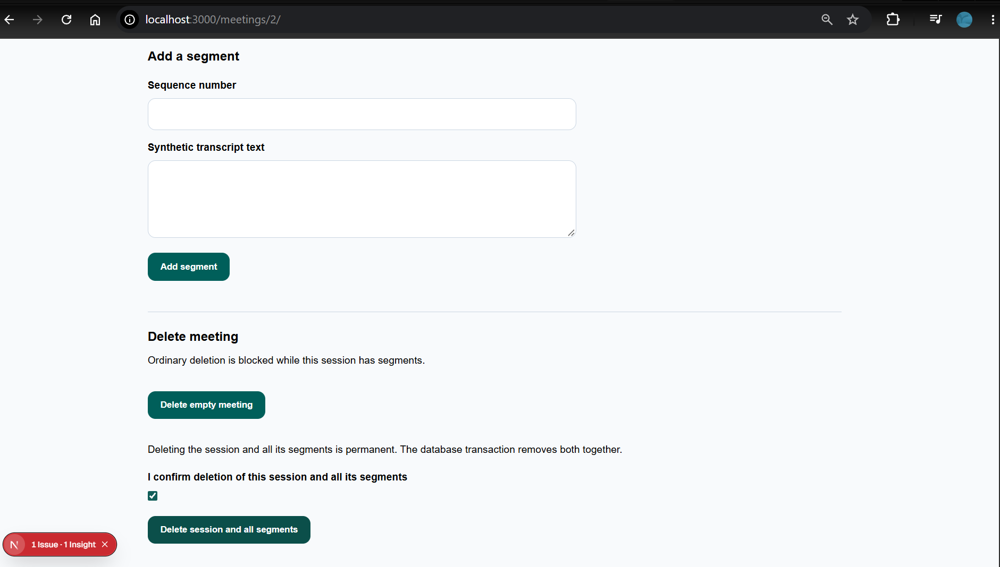

**Gambar 18.** Pada ID 2, checkbox konfirmasi sudah dicentang dan tombol Delete session and all segments tersedia. Gambar sebagai **bukti tahap konfirmasi sebelum penghapusan**, bukan bukti redirect, parent terhapus, atau child terhapus. Keberhasilan transaksi didukung PASS 13 pada gambar 17 dan assertion jumlah parent/child sama-sama nol dalam script.

Nomor aktual 17 adalah rollback dan 18 adalah konfirmasi transaksi. Screenshot skenario terpisah dari panduan awal tidak diperlukan karena hasil lengkap sudah tercakup pada gambar 17.

## 6. Skenario Uji

Tabel berikut mengikuti **13 label run database pada gambar 17**, bukan menggabungkan jumlah tes unit/browser menjadi satu persentase. Input pengujian semuanya sintetis, dengan prefix unik `M06-TEST-<UUID>`. Script membersihkan record miliknya berdasarkan ID dan prefix; tidak melakukan reset database atau menghapus fixture seed.

| No. | Tindakan / input                                             | Hasil yang diharapkan                                    | Hasil aktual pada run gambar 17                 | Status |
| --- | ------------------------------------------------------------ | -------------------------------------------------------- | ----------------------------------------------- | ------ |
| 01  | Buat sesi berkode unik melalui shared mutation               | ID positif dan tujuan detail dihasilkan                  | Assertion ID lolos; PASS 01                     | Lulus  |
| 02  | Baca daftar/detail snapshot fixture                          | Satu sesi sesuai ID, tanpa child                         | Jumlah, ID dan child kosong cocok; PASS 02      | Lulus  |
| 03  | Ubah title dan sessionCode sesi                              | Metadata tersimpan, judul sesuai nilai baru              | Assertion judul terbaru lolos; PASS 03          | Lulus  |
| 04  | Buat child sequence 1 dengan teks sintetis                   | IV 12 byte; ciphertext tidak memuat plaintext fixture    | Kedua pemeriksaan lolos; PASS 04                | Lulus  |
| 05  | Dekripsi child dengan identitas/kunci yang benar             | Teks persis sama, termasuk newline                       | Perbandingan string lolos; PASS 05              | Lulus  |
| 06  | Edit teks child                                              | IV berbeda, sequence tetap 1, teks baru dapat didekripsi | Seluruh assertion lolos; PASS 06                | Lulus  |
| 07  | Ulangi sessionCode dan sequence dalam parent yang sama       | Kedua operasi ditolak P2002                              | Kedua penolakan sesuai; PASS 07                 | Lulus  |
| 08  | Buat orphan secara langsung dan hapus parent berisi child    | Kedua operasi ditolak P2003                              | FK dan RESTRICT bekerja; PASS 08                | Lulus  |
| 09  | Hapus child dalam transaksi lalu lempar error                | Rollback mengembalikan seluruh snapshot                  | Jumlah 1/1, hash sama, deepEqual lolos; PASS 09 | Lulus  |
| 10  | Update/delete child dengan sessionId parent lain             | P2025, tidak mengubah child tersebut                     | Kedua operasi ditolak; PASS 10                  | Lulus  |
| 11  | Hapus child lalu edit melalui ID lama                        | Child hilang, stale update ditolak P2025                 | Jumlah child nol dan penolakan sesuai; PASS 11  | Lulus  |
| 12  | Hapus parent kosong lalu edit ID lama                        | Parent terhapus, update ditolak P2025                    | Delete berhasil dan update ditolak; PASS 12     | Lulus  |
| 13  | Buat child lalu hapus parent beserta child melalui transaksi | Jumlah parent dan child terkait menjadi nol              | Kedua assertion jumlah nol lolos; PASS 13       | Lulus  |

**Persentase kelulusan run database: 13 ÷ 13 × 100% = 100%.** Melebihi minimum 10 skenario dan ambang 90%; tidak berarti semua fitur produk atau seluruh rubrik otomatis mendapat nilai penuh.

Hasil otomatis historis berikut berasal dari [EVALUASI.md](../../EVALUASI.md), entri **2 November 2026**, bukan pengujian ulang saat penulisan dokumen:

| Pemeriksaan historis                 | Hasil tercatat                                                                  |
| ------------------------------------ | ------------------------------------------------------------------------------- |
| `npm run check`                      | Lint, typecheck, formatting, 146/146 unit tests dalam 10 file lulus.            |
| `npm run db:test`                    | 13/13 skenario database lulus pada run historis tersendiri.                     |
| `npm run db:verify -- --seed-twice`  | Seed berulang mempertahankan snapshot dan dekripsi lintas proses berhasil.      |
| `npm run build`                      | Gagal pada startup CSS-worker Turbopack.                                        |
| `npm run build -- --webpack`         | Build produksi berhasil setelah penanganan hambatan lingkungan/peringatan.      |
| Browser suite lengkap                | 111/111 pada viewport 390/768/1280, localhost:3101, database tests diaktifkan.  |
| Pemeriksaan browser meeting terakhir | 15/15 setelah perbaikan wrapping title/kode maksimum dan assertion same-origin. |

Tes browser mencakup CRUD, duplicate/stale forms, retry/pending, missing/forged session, ciphertext rusak dan pembatasan media/persistence browser. Tes database baru diaktifkan melalui `PLAYWRIGHT_DATABASE=1`; tes yang dilewati tidak boleh dihitung sebagai lulus. Screenshot manual UI memakai localhost:3000, berbeda dari server otomatis historis.

**Pemetaan rubrik dokumen:**

| Kriteria         | Bobot | Bagian / bukti                                         | Batas klaim                                                                                 |
| ---------------- | ----- | ------------------------------------------------------ | ------------------------------------------------------------------------------------------- |
| Ketepatan teknis | 35%   | Bagian 1–5, schema/migrasi, CRUD dan transaksi         | Migrasi harus disertakan dalam commit; status database bukan bukti publikasi Git. |
| Bukti pengujian  | 30%   | Gambar 01–05, 13–17, tabel 13 skenario                 | Gambar 18 hanya konfirmasi; hasil transaksi mengacu PASS 13.                                |
| Keputusan teknis | 20%   | Relasi, unique, RESTRICT, upsert, transaksi interaktif | Lab satu akun dan enkripsi at rest, bukan sistem produksi.                                  |
| Pemanfaatan AI   | 15%   | Bagian 8 dan AI_LOG                                    | Bantuan AI diungkap; pemahaman dan penjelasan tetap diperlukan.                   |

## 7. Kendala dan Penyelesaian

| Kendala                                                   | Penanganan / status                                                                                                                                                                                                                                             |
| --------------------------------------------------------- | --------------------------------------------------------------------------------------------------------------------------------------------------------------------------------------------------------------------------------------------------------------- |
| Turbopack gagal memulai CSS-worker                        | Build Webpack berhasil secara historis. Script build default tidak diam-diam diganti; kegagalan Turbopack belum diselesaikan.                                                                                                                                   |
| EPERM menulis output build dalam sandbox                  | Build di luar sandbox yang disetujui berhasil. Ini kendala lingkungan, bukan bukti kegagalan schema.                                                                                                                                                            |
| Peringatan kerentanan Next.js                             | Retry build dapat berhasil, tetapi versi belum di-upgrade dan risiko deployment tetap terbuka. Tidak mengklaim siap produksi.                                                                                                                                   |
| Assertion/locator tes awal tidak tepat                    | Union TypeScript, alias Vitest, pencocokan string terlalu luas, dan locator ambigu diperbaiki sebelum hasil historis lulus.                                                                                                                                     |
| Screenshot P2025 awal hanya not-found                     | Diganti dengan gambar 15 yang menunjukkan form edit, pesan stale record dan input yang tetap terisi.                                                                                                                                                            |

Jika seed yang hilang dibuat kembali, ID, timestamp, IV dan ciphertext dapat berubah meskipun teks fixture sama. Karena itu hasil idempotensi pada gambar 04–05 berlaku untuk run yang direkam; bukan klaim bahwa record tetap identik melewati kejadian penghapusan.

Indikator Issues pada screenshot development tidak cukup untuk menentukan penyebabnya. Dokumen tidak menyimpulkan penyebab indikator dari gambar saja, maupun menyatakan seluruh masalah runtime telah hilang.

## 8. Catatan Pemanfaatan AI

Alat: **OpenAI Codex**, peran pendamping rekayasa perangkat lunak dan penyusunan dokumentasi. Catatan kumulatif terdapat pada [AI_LOG.md](../../AI_LOG.md).

| Tahap bantuan    | Prompt / tujuan utama                                                                                     | Bagian yang digunakan                                                        | Cara verifikasi                                                                                                                                       |
| ---------------- | --------------------------------------------------------------------------------------------------------- | ---------------------------------------------------------------------------- | ----------------------------------------------------------------------------------------------------------------------------------------------------- |
| Fondasi database | Integrasikan desain MeetingSession–TranscriptSegment dengan Prisma/PostgreSQL dan kunci lab persisten     | Schema, migrasi, seed, client, adapter crypto, verifier                      | Pemeriksaan schema/migrasi, seed berulang, dekripsi lintas proses dan crypto tests.                                                                   |
| Meeting lab      | Implementasikan CRUD terpisah, shared demo session, transaksi dan rollback tanpa media processing         | Routes/form/action/repository, validasi, pesan galat, database/browser tests | Hasil historis check/build/database/browser pada bagian 6.                                                                                            |
| Bukti manual     | Jelaskan langkah pgAdmin, seed, CRUD, P2025 dan rollback; tinjau screenshot                               | Panduan dan interpretasi bukti                                               | Secara manual mengambil seluruh gambar; Codex memeriksa isi yang terlihat dan membatasi caption sesuai bukti.                                             |
| Dokumen teknis   | Susun delapan bagian H dengan 18 gambar; pertahankan gambar 18 dan keputusan melewati screenshot tertentu | Dokumen ini, tautan README dan catatan pekerjaan                             | Cocokkan cuplikan dengan sumber aktual, periksa heading/diagram/tautan gambar serta jumlah skenario. Tidak menjalankan ulang database saat penulisan. |
