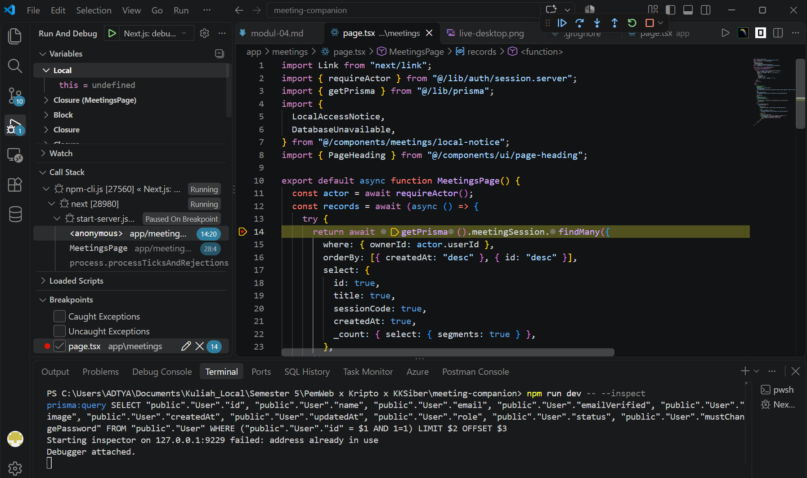
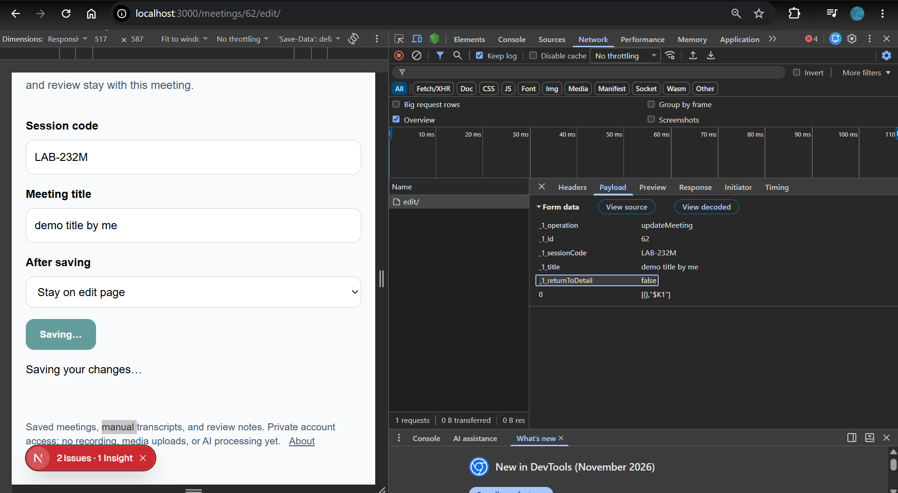
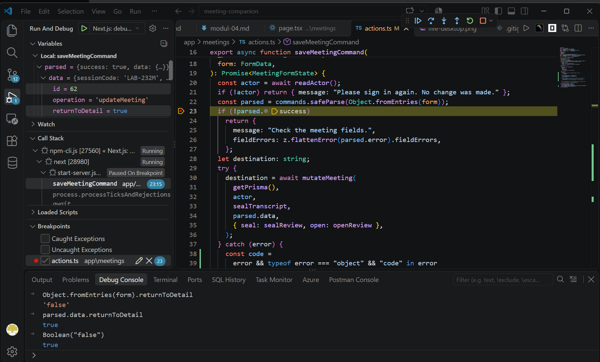
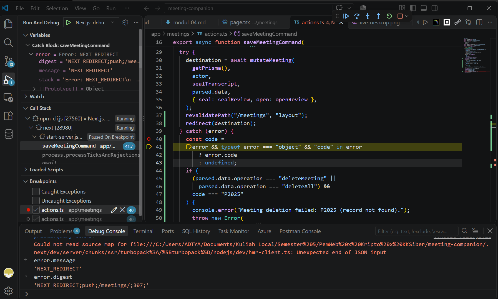
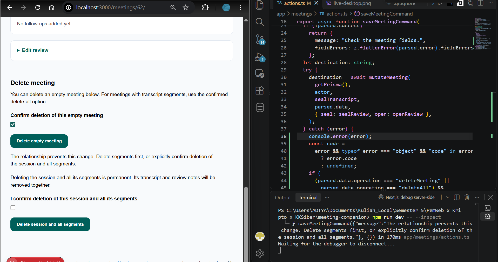
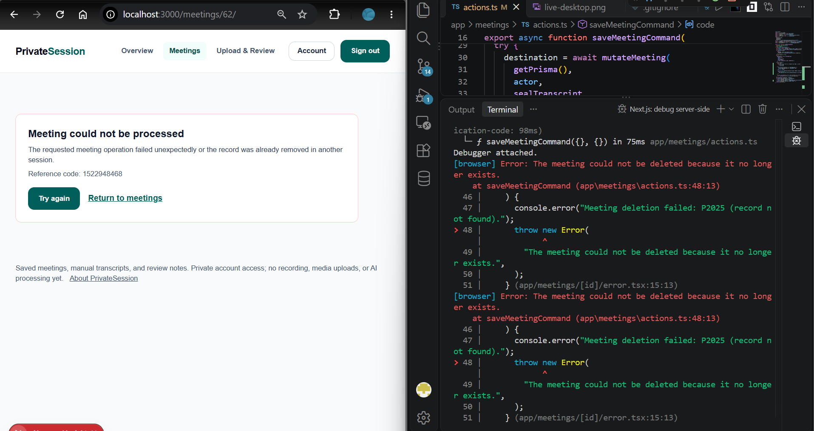
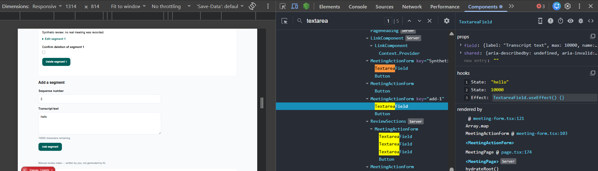
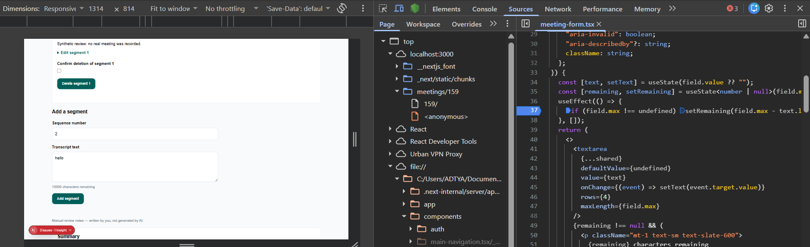

# Dokumen Teknis Modul 7 — Debugging dan Telaah Kode

Nama/NIM : Erlangga Aditya Permana / 105224038  
Repositori : <https://github.com/xvasgit/PrivateSession>  
Branch kerja : `praktikum/modul-07`  
Pull request : <https://github.com/xvasgit/PrivateSession/pull/7>

---

## 1. Lingkungan dan Konfigurasi Debugger

- **Node.js:** `v24.13.0` (`npm 11.6.2`)
- **Framework:** `Next.js 16.4.5` di `package.json` (`16.4.0` terpasang di `node_modules` Windows lokal sebelum `npm ci` ulang) (App Router, Server Actions, Webpack dev/build fallback)
- **ORM & Database:** `Prisma ORM 7.10.1` (`@prisma/adapter-pg` `7.10.1`), `PostgreSQL 18`
- **Validasi:** `Zod 4.6.7`
- **Peramban:** Google Chrome (DevTools: Sources, Network, Console + ekstensi React Developer Tools)
- **Hash commit awal (`main`):** `cfb3af4` (`milestone2: container and OS hardening, zero-critical image scans, and SBOM`)

### Konfigurasi `.vscode/launch.json`

Konfigurasi debugger disimpan di [.vscode/launch.json](../../.vscode/launch.json) mengikuti panduan debugging Next.js 16 dengan opsi `debugWithChrome` pada konfigurasi _full stack_ serta menyalakan `PRISMA_QUERY_LOG=true` khusus selama sesi debug server:

```json
{
  "version": "0.2.0",
  "configurations": [
    {
      "name": "Next.js: debug server-side",
      "type": "node-terminal",
      "request": "launch",
      "command": "npm run dev -- --inspect",
      "env": {
        "PRISMA_QUERY_LOG": "true"
      }
    },
    {
      "name": "Next.js: debug client-side",
      "type": "chrome",
      "request": "launch",
      "url": "http://localhost:3000"
    },
    {
      "name": "Next.js: debug full stack",
      "type": "node",
      "request": "launch",
      "program": "${workspaceFolder}/node_modules/next/dist/bin/next",
      "runtimeArgs": ["--inspect"],
      "env": {
        "PRISMA_QUERY_LOG": "true"
      },
      "skipFiles": ["<node_internals>/**"],
      "serverReadyAction": {
        "action": "debugWithChrome",
        "killOnServerStop": true,
        "pattern": "- Local:.+(https?://.+)",
        "uriFormat": "%s",
        "webRoot": "${workspaceFolder}"
      }
    }
  ]
}
```

### Konfigurasi Log Query Prisma (`lib/prisma.ts`)

Pada [lib/prisma.ts](../../lib/prisma.ts), logging `"query"` pada lingkungan `"development"` dibatasi hanya aktif saat `process.env.PRISMA_QUERY_LOG === "true"` (diaktifkan otomatis oleh konfigurasi debug VS Code di atas atau melalui variabel lingkungan sesi penelusuran) sesuai saran telaah kode pasangan agar database staging/pengembangan bersama tidak mencetak query mentah secara default, sementara `"development"` reguler memakai `["warn", "error"]` dan `"test"`/`"production"` tetap `[]`:

```ts
export function getPrisma(): PrismaClient {
  return (globals.privateSessionDatabase ??= new PrismaClient({
    adapter: new PrismaPg({
      connectionString: localDatabaseUrl(process.env.DATABASE_URL),
      connectionTimeoutMillis: 5000,
    }),
    log:
      process.env.NODE_ENV === "development"
        ? process.env.PRISMA_QUERY_LOG === "true"
          ? ["query", "warn", "error"]
          : ["warn", "error"]
        : [],
    errorFormat: "minimal",
  }));
}
```

### Bukti Debugger Berhenti di Server Component



**Gambar 01.** Debugger VS Code berhenti pada _breakpoint_ baris 14 (`getPrisma().meetingSession.findMany`) di [app/meetings/page.tsx](../../app/meetings/page.tsx). Panel **Call Stack** menunjukkan `MeetingsPage`, dan terminal debug menampilkan log query Prisma `prisma:query SELECT ... FROM "public"."User" ...` dari pemeriksaan sesi sebelum query daftar rapat dieksekusi.

---

## 2. Daftar Galat

| No  | Issue                                                    | Gejala                                                                                                                                                  | Lapisan                                                                                        | Akar penyebab                                                                                                                                                                   | Commit perbaikan                                                                             |
| --- | -------------------------------------------------------- | ------------------------------------------------------------------------------------------------------------------------------------------------------- | ---------------------------------------------------------------------------------------------- | ------------------------------------------------------------------------------------------------------------------------------------------------------------------------------- | -------------------------------------------------------------------------------------------- |
| 1   | [#3](https://github.com/xvasgit/PrivateSession/issues/3) | Pilihan `"Stay on edit page"` (`returnToDetail = "false"`) pada `/meetings/[id]/edit/` tetap memindahkan pengguna ke halaman detail setelah menyimpan   | Server (`lib/meetings/schema.ts` & `app/meetings/actions.ts`)                                  | Skema usulan AI memakai `z.coerce.boolean()` yang mengevaluasi `Boolean("false") === true`, bukan `z.stringbool()`                                                              | `ca129df` (`fix(meetings): parse returnToDetail and confirmation with z.stringbool (#A)`)    |
| 2   | [#4](https://github.com/xvasgit/PrivateSession/issues/4) | Menghapus `MeetingSession` kosong membatalkan navigasi ke `/meetings/` dan mencetak `"Gagal menghapus"` di terminal meskipun baris terhapus di DB       | Server Action (`app/meetings/actions.ts`)                                                      | Pemanggilan `redirect(destination)` berada di dalam blok `try/catch` sehingga galat khusus `NEXT_REDIRECT` ikut tertangkap `catch`                                              | `956062c` (`fix(meetings): keep redirect outside try/catch and add [id]/error.tsx (#B, #C)`) |
| 3   | [#5](https://github.com/xvasgit/PrivateSession/issues/5) | Menghapus `MeetingSession` bersegmen (`P2003`) atau sesi yang sudah dihapus di tab lain (`P2025`) gagal diam-diam tanpa pesan atau fallback `error.tsx` | Server Action, DB & Error Boundary (`app/meetings/actions.ts` & `app/meetings/[id]/error.tsx`) | Blok `catch` usulan AI menelan objek galat (`console.log("Gagal menghapus")`), serta belum ada `app/meetings/[id]/error.tsx` untuk menangani galat tak terduga dengan `retry()` | `956062c` (`fix(meetings): keep redirect outside try/catch and add [id]/error.tsx (#B, #C)`) |
| 4   | [#6](https://github.com/xvasgit/PrivateSession/issues/6) | Penghitung `"10000 characters remaining"` pada kolom teks transkrip dan ulasan tidak berubah saat mengetik                                              | Client Component (`components/meetings/meeting-form.tsx`)                                      | Kode usulan AI menyimpan nilai turunan di `useState` terpisah dan memperbaruinya lewat `useEffect(..., [])` berlarik dependensi kosong                                          | `d225793` (`fix(meetings): derive remaining characters during render (#D)`)                  |

---

## 3. Catatan Penelusuran

### 3.1 Galat 1: Pilihan `"Stay on edit page"` (`returnToDetail = "false"`) selalu berpindah halaman

#### Langkah Reproduksi — Issue [#3](https://github.com/xvasgit/PrivateSession/issues/3)

- **Lingkungan:** Node.js v24.13.0, Next.js 16.4.5, Prisma 7.10.1, Zod 4.6.7, Chrome, branch `praktikum/modul-07` (basis commit `cfb3af4`)
- **Data awal:** Satu `MeetingSession` sintetis milik akun uji aktif, diakses melalui `/meetings/[id]/edit/`.
- **Langkah reproduksi:**
  1. Jalankan konfigurasi `"Next.js: debug server-side"` dan buka `/meetings/[id]/edit/`.
  2. Ubah judul rapat menjadi `"Synthetic Meeting Revised"`.
  3. Pada dropdown **After saving**, pilih `"Stay on edit page"` (`value="false"`).
  4. Klik **Save meeting**.
- **Hasil yang diharapkan:** Tetap berada di halaman `/meetings/[id]/edit/` dengan pesan status `"Meeting changes saved."`.
- **Hasil aktual:** Halaman langsung berpindah (_redirect_) ke `/meetings/[id]/`.
- **Frekuensi:** 5 dari 5 percobaan.
- **Bukti:** Payload Network (`Next-Action`) berisi `returnToDetail: "false"`, namun di Debug Console VS Code nilai `parsed.data.returnToDetail` terbaca `true`.

#### Bukti Sebelum Perbaikan

1. **Lapisan Jaringan (DevTools → Network):** Pada permintaan `POST` ke `/meetings/[id]/edit/` (dengan header `Next-Action`), tab **Payload** menampilkan `returnToDetail: "false"`. Artinya browser sudah mengirimkan string `"false"` dengan benar, sehingga penyimpangan terjadi di server.
2. **Lapisan Server (Debugger VS Code → Variables & Debug Console):** Saat _breakpoint_ berhenti setelah `commands.safeParse(Object.fromEntries(form))` di [app/meetings/actions.ts](../../app/meetings/actions.ts), evaluasi di **Debug Console**:
   ```text
   > Object.fromEntries(form).returnToDetail
   'false'
   > parsed.data.returnToDetail
   true
   > Boolean("false")
   true
   > Boolean("")
   false
   ```



**Gambar 02.** Tab **Network → Payload** Chrome DevTools pada permintaan `edit/` (`/meetings/62/edit/`) menunjukkan browser mengirim `_1_operation: updateMeeting` dan `_1_returnToDetail: false` sesuai pilihan `"Stay on edit page"`.



**Gambar 03.** Debugger VS Code berhenti pada baris 23 [app/meetings/actions.ts](../../app/meetings/actions.ts). Panel **Variables** memperlihatkan `parsed.data.returnToDetail = true`, dan **Debug Console** mengonfirmasi bahwa `Object.fromEntries(form).returnToDetail` bernilai `'false'` sementara `parsed.data.returnToDetail` serta `Boolean("false")` mengevaluasi `true`.

#### Akar Penyebab dan Perbaikan

- **Akar penyebab:** `z.coerce.boolean()` di Zod memanggil konstruktor JavaScript `Boolean(input)`. Semua string non-kosong—termasuk `"false"` dan `"off"`—bernilai truthy (`true`).
- **Sebelum perbaikan (usulan AI di `lib/meetings/schema.ts`):**
  ```ts
  meetingSchema.extend({
    operation: z.literal("updateMeeting"),
    id: positiveId,
    returnToDetail: z.coerce.boolean().default(true),
  }),
  ```
- **Sesudah perbaikan ([lib/meetings/schema.ts](../../lib/meetings/schema.ts) baris 23–34 & [app/meetings/actions.ts](../../app/meetings/actions.ts) baris 58–62):**
  ```ts
  // lib/meetings/schema.ts
  export const confirmationSchema = (message: string) =>
    z
      .stringbool({ error: message })
      .refine((confirmed) => confirmed, { error: message });

  // di dalam commands:
  meetingSchema.extend({
    operation: z.literal("updateMeeting"),
    id: positiveId,
    returnToDetail: z.stringbool().default(true),
  }),
  ```
  ```ts
  // app/meetings/actions.ts
  if (parsed.data.operation === "updateMeeting" && !parsed.data.returnToDetail)
    return { message: "Meeting changes saved." };
  ```

#### Bukti Sesudah Perbaikan

- Mengulangi langkah 1–4 sebanyak **5 dari 5 percobaan**: pada _breakpoint_ `app/meetings/actions.ts`, `parsed.data.returnToDetail` bernilai `false`, halaman tetap berada di `/meetings/[id]/edit/`, dan pesan status `"Meeting changes saved."` tampil.
- Terverifikasi otomatis melalui unit test `stays on edit page without redirecting when returnToDetail is false` dan validasi `z.stringbool()` di [tests/database/meetings.test.ts](../../tests/database/meetings.test.ts).

---

### 3.2 Galat 2: Penghapusan sesi rapat kosong tidak berpindah ke `/meetings/` karena `redirect()` tertelan `catch`

#### Langkah Reproduksi — Issue [#4](https://github.com/xvasgit/PrivateSession/issues/4)

- **Lingkungan:** Node.js v24.13.0, Next.js 16.4.5, Prisma 7.10.1, Chrome, branch `praktikum/modul-07` (basis commit `cfb3af4`)
- **Data awal:** Satu `MeetingSession` sintetis tanpa `TranscriptSegment`, dibuka di `/meetings/[id]/`.
- **Langkah reproduksi:**
  1. Jalankan konfigurasi `"Next.js: debug server-side"` dan pasang breakpoint di dalam blok `catch` Server Action hapus rapat.
  2. Buka `/meetings/[id]/` untuk sesi rapat tanpa segmen.
  3. Centang konfirmasi **Confirm deletion of this empty meeting** dan klik **Delete empty meeting**.
- **Hasil yang diharapkan:** Sesi rapat terhapus dan pengguna langsung diarahkan kembali ke `/meetings/`.
- **Hasil aktual:** Halaman tidak berpindah dari `/meetings/[id]/`, terminal debug mencetak `"Gagal menghapus"`, namun data rapat sudah hilang saat daftar `/meetings/` dimuat ulang.
- **Frekuensi:** 5 dari 5 percobaan.
- **Bukti:** Call Stack VS Code berhenti di blok `catch`; Debug Console menunjukkan `e.message === "NEXT_REDIRECT"` dan `e.digest` berawalan `"NEXT_REDIRECT;push;/meetings/;..."`.

#### Bukti Sebelum Perbaikan

- Saat _breakpoint_ berhenti di dalam blok `catch (error)` yang membungkus `redirect()`, hasil inspeksi di **Debug Console** dan **Call Stack** VS Code:
  ```text
  > error.message
  'NEXT_REDIRECT'
  > error.digest
  'NEXT_REDIRECT;push;/meetings/;303;'
  // Call Stack:
  // saveMeetingCommand (app/meetings/actions.ts)
  ```
- Log terminal menampilkan `prisma:query DELETE FROM "MeetingSession" ...` diikuti `"Gagal menghapus"` — menandakan operasi database berhasil, tetapi kontrol navigasi Next.js dibatalkan oleh `catch`.



**Gambar 04.** Ketika `revalidatePath` dan `redirect(destination)` berada di dalam blok `try`, eksekusi berhenti pada _breakpoint_ baris 41 di dalam blok `catch (error)` [app/meetings/actions.ts](../../app/meetings/actions.ts). Panel **Variables** dan **Debug Console** memperlihatkan `error.message === 'NEXT_REDIRECT'` serta `error.digest === 'NEXT_REDIRECT;push;/meetings/;307;'`.

#### Akar Penyebab dan Perbaikan

- **Akar penyebab:** Sesuai dokumentasi resmi Next.js 16 (`redirect.md`), fungsi `redirect()` bekerja dengan melempar pengecualian internal `NEXT_REDIRECT`. Meletakkan `redirect(destination)` di dalam blok `try` menyebabkan `catch` menangkapnya layaknya kegagalan.
- **Sebelum perbaikan (pola usulan AI):**
  ```ts
  try {
    destination = await mutateMeeting(...);
    revalidatePath("/meetings", "layout");
    redirect(destination);
  } catch (e) {
    console.log("Gagal menghapus");
    return { message: "Gagal menghapus." };
  }
  ```
- **Sesudah perbaikan ([app/meetings/actions.ts](../../app/meetings/actions.ts) baris 29–63):**
  ```ts
  try {
    destination = await mutateMeeting(
      getPrisma(),
      actor,
      sealTranscript,
      parsed.data,
      { seal: sealReview, open: openReview },
    );
  } catch (error) {
    // penanganan error domain / rethrow P2025 hapus ...
  }
  revalidatePath("/meetings", "layout");
  // ...
  redirect(destination); // di luar blok try/catch
  ```

#### Bukti Sesudah Perbaikan

- Mengulangi langkah 1–3 sebanyak **5 dari 5 percobaan**: menghapus sesi rapat kosong tidak lagi masuk ke blok `catch`, melakukan `revalidatePath("/meetings", "layout")`, dan langsung mengarahkan peramban ke `/meetings/` dengan rapat tersebut hilang dari daftar.
- Terverifikasi otomatis melalui unit test `mutates before revalidation and lets redirect escape` di [tests/database/meetings.test.ts](../../tests/database/meetings.test.ts).

---

### 3.3 Galat 3: Penghapusan sesi bersegmen (`P2003`) dan penghapusan tab ganda (`P2025`) gagal diam-diam

#### Langkah Reproduksi — Issue [#5](https://github.com/xvasgit/PrivateSession/issues/5)

- **Lingkungan:** Node.js v24.13.0, Next.js 16.4.5, Prisma 7.10.1, PostgreSQL 18, Chrome, branch `praktikum/modul-07` (basis commit `cfb3af4`)
- **Data awal:** Satu `MeetingSession` sintetis yang memiliki minimal 1 `TranscriptSegment` di PostgreSQL.
- **Langkah reproduksi:**
  1. **Skenario A (`P2003`):** Buka `/meetings/[id]/` pada sesi yang memiliki segmen. Centang konfirmasi **Delete empty meeting** lalu klik tombol tersebut.
  2. **Skenario B (`P2025`):** Buka halaman detail `/meetings/[id]/` sesi yang sama di **Tab 1** dan **Tab 2**. Pada **Tab 1**, hapus sesi memakai **Delete session and all segments**. Pada **Tab 2**, centang konfirmasi hapus lalu klik **Delete session and all segments**.
- **Hasil yang diharapkan:**
  - Skenario A menampilkan pesan aman yang menjelaskan relasi segmen (`onDelete: Restrict`) dan mengarahkan ke opsi hapus-semua bertransaksi (`deleteAll`).
  - Skenario B meneruskan `P2025` ke _error boundary_ [app/meetings/[id]/error.tsx](../../app/meetings/%5Bid%5D/error.tsx) sehingga tampil fallback ramah beserta `error.digest` dan tombol `Try again` (`retry()`), serta stack trace tercatat di log server.
- **Hasil aktual (pada kode usulan AI):** Kedua skenario menghasilkan log terminal identik `"Gagal menghapus"`, objek galat ditelan `catch`, dan pengguna tidak memperoleh pesan galat ataupun _error boundary_.
- **Frekuensi:** 5 dari 5 percobaan.
- **Bukti:** Terminal stack trace setelah mengubah `console.log` sementara menjadi `console.error(error)` menampilkan `PrismaClientKnownRequestError` dengan `code: 'P2003'` (skenario A) dan `code: 'P2025'` (skenario B).

#### Bukti Sebelum Perbaikan

Saat log asli `console.log("Gagal menghapus")` diganti sementara dengan `console.error(error)`, stack trace terminal menampilkan frame pertama pada kode aplikasi (`lib/meetings/repository.ts` dan `app/meetings/actions.ts`) beserta kode Prisma:

```text
PrismaClientKnownRequestError:
Invalid `tx.meetingSession.delete()` invocation in .../lib/meetings/repository.ts:90
  Foreign key constraint violated on the constraint: `TranscriptSegment_sessionId_fkey`
  code: 'P2003'
  at async mutateMeeting (.../lib/meetings/repository.ts:90:9)
  at async saveMeetingCommand (.../app/meetings/actions.ts:30:19)
```

Pada skenario B (tab kedua):

```text
PrismaClientKnownRequestError:
Invalid `tx.meetingSession.findUniqueOrThrow()` invocation in .../lib/meetings/repository.ts:37
  No MeetingSession found
  code: 'P2025'
```



**Gambar 05.** Skenario `P2003` pada sesi bersegmen (`/meetings/62/`): saat tombol **Delete empty meeting** diklik tanpa menghapus segmen terlebih dahulu, browser menampilkan pesan penolakan aman `"The relationship prevents this change. Delete segments first, or explicitly confirm deletion of the session and all segments."` sementara panel VS Code menampilkan blok `catch` (`console.error(error)`) dan ringkasan eksekusi `saveMeetingCommand` di terminal.



**Gambar 06.** Skenario `P2025` sesudah perbaikan pada penghapusan tab kedua (`/meetings/62/`): terminal VS Code mencatat `"Meeting deletion failed: P2025 (record not found)."` beserta _stack trace_ `saveMeetingCommand` (`app/meetings/actions.ts:48:13`) ke `app/meetings/[id]/error.tsx:15:13`, dan halaman menampilkan fallback `"Meeting could not be processed"`, `Reference code: 1522948468`, tombol **Try again**, serta tautan **Return to meetings**.

#### Akar Penyebab dan Perbaikan

- **Akar penyebab:**
  1. Blok `catch` generik pada kode usulan AI menelan semua `PrismaClientKnownRequestError` (anti-pola OWASP A10 _Mishandling of Exceptional Conditions_), sehingga `P2003` (`onDelete: Restrict` dari `TranscriptSegment.sessionId`) dan `P2025` (_record_ tidak ditemukan karena sudah dihapus tab lain) menghasilkan gejala bisu yang sama.
  2. Segmen rute `app/meetings/[id]/` belum memiliki berkas [error.tsx](../../app/meetings/%5Bid%5D/error.tsx) (`"use client"`) untuk menangkap galat tak terduga dengan `error.digest` dan `retry()`.
- **Perbaikan di [app/meetings/actions.ts](../../app/meetings/actions.ts) (baris 37–54):**
  - `P2003` dipetakan secara aman oleh [meetingError](../../lib/meetings/errors.ts) menjadi pesan ramah yang menjaga integritas `onDelete: Restrict` dan memandu pengguna memakai aksi transaksi `deleteAll` (`$transaction` di [lib/meetings/repository.ts](../../lib/meetings/repository.ts) baris 92–99).
  - `P2025` pada operasi penghapusan (`deleteMeeting` / `deleteAll`) dicatat kodenya ke log server (`console.error("Meeting deletion failed: P2025 (record not found).")`) tanpa membocorkan data formulir lalu dilempar ulang agar ditangkap oleh [app/meetings/[id]/error.tsx](../../app/meetings/%5Bid%5D/error.tsx).
- **Perbaikan di [components/meetings/meeting-form.tsx](../../components/meetings/meeting-form.tsx) (baris 74–88):**
  ```ts
  } catch (error) {
    unstable_rethrow(error);
    if (
      (error && typeof error === "object" && "digest" in error) ||
      (error instanceof Error &&
        error.message ===
          "The meeting could not be deleted because it no longer exists.")
    ) {
      throw error;
    }
    return {
      message:
        "The request could not be completed. Your entries are still here; please retry.",
    };
  }
  ```
- **Berkas baru [app/meetings/[id]/error.tsx](../../app/meetings/%5Bid%5D/error.tsx):**
  ```tsx
  "use client";

  import Link from "next/link";
  import { useEffect } from "react";
  import { Button } from "@/components/ui/button";

  export default function MeetingError({
    error,
    retry,
  }: {
    error: Error & { digest?: string };
    retry: () => void;
  }) {
    useEffect(() => {
      console.error(error);
    }, [error]);

    return (
      <div
        role="alert"
        className="my-6 max-w-2xl rounded-xl border border-red-200 bg-white p-6"
      >
        <h2 className="text-xl font-bold text-slate-900">
          Meeting could not be processed
        </h2>
        <p className="mt-2 text-sm text-slate-700">
          The requested meeting operation failed unexpectedly or the record was
          already removed in another session.
        </p>
        <p className="mt-2 text-sm text-slate-600">
          Reference code: {error.digest ?? "unavailable"}
        </p>
        <div className="mt-4 flex flex-wrap items-center gap-4">
          <Button type="button" onClick={() => retry()}>
            Try again
          </Button>
          <Link
            href="/meetings/"
            className="font-semibold text-teal-800 underline"
          >
            Return to meetings
          </Link>
        </div>
      </div>
    );
  }
  ```

#### Bukti Sesudah Perbaikan

- **Skenario A (`P2003`):** Mengulangi 5 dari 5 kali, tombol **Delete empty meeting** pada rapat bersegmen selalu ditolak dengan pesan `"The relationship prevents this change. Delete segments first, or explicitly confirm deletion of the session and all segments."`, sedangkan **Delete session and all segments** berhasil menghapus anak dan induk secara atomik lalu berpindah ke `/meetings/`.
- **Skenario B (`P2025` tab ganda):** Mengulangi 5 dari 5 kali, menghapus di Tab 2 setelah dihapus di Tab 1 mencatat `Meeting deletion failed: P2025 (record not found).` di terminal dan menampilkan fallback `"Meeting could not be processed"` beserta `Reference code` (`error.digest`) dan tombol **Try again** (`retry()`).
- Terverifikasi otomatis melalui unit test `rethrows P2025 on delete operations so the route error boundary handles stale deletion` di [tests/database/meetings.test.ts](../../tests/database/meetings.test.ts).

---

### 3.4 Galat 4: Penghitung sisa karakter transkrip dan ulasan tidak berubah saat mengetik

#### Langkah Reproduksi — Issue [#6](https://github.com/xvasgit/PrivateSession/issues/6)

- **Lingkungan:** Node.js v24.13.0, Next.js 16.4.5, React 19.3.0, Chrome + React Developer Tools, branch `praktikum/modul-07` (basis commit `cfb3af4`)
- **Data awal:** Halaman detail `/meetings/[id]/` dengan formulir **Add a segment** (`Transcript text`, maksimal 10.000 karakter).
- **Langkah reproduksi:**
  1. Buka `/meetings/[id]/` di Chrome bersama tab **Components** (React Developer Tools).
  2. Pilih komponen `TextareaField` di bawah `MeetingActionForm`.
  3. Ketik `"hello"` pada kolom **Transcript text**.
- **Hasil yang diharapkan:** Teks penghitung langsung berubah menjadi `"9995 characters remaining"`.
- **Hasil aktual (pada kode usulan AI):** State `text` berubah menjadi `"hello"`, tetapi state `remaining` dan tampilan tetap `"10000 characters remaining"`.
- **Frekuensi:** 5 dari 5 percobaan.
- **Bukti:** Tab **Components** React Developer Tools menampilkan hook `State` pertama berubah menjadi `"hello"` sementara `State` kedua tetap `10000`, serta breakpoint di dalam `useEffect` (tab **Sources**) tidak pernah tersentuh saat mengetik.

#### Bukti Sebelum Perbaikan

- Pada **React Developer Tools → Components**, komponen formulir memegang dua _hook_ `useState`: `text` berubah setiap ketikan, tetapi `remaining` tetap `10000`.
- Pada **Chrome DevTools → Sources** (`Ctrl+P` → `meeting-form.tsx`), _breakpoint_ di dalam `useEffect(..., [])` hanya tersentuh saat _mount_ awal (dua kali pada mode development akibat React Strict Mode) dan tidak pernah tersentuh ketika event `onChange` dipicu.



**Gambar 07.** Tab **Components** React Developer Tools pada `TextareaField` (`MeetingActionForm key="add-1"`): kolom **Transcript text** berisi `"hello"` dengan label tetap `"10000 characters remaining"`, sementara daftar _hooks_ memperlihatkan `State: "hello"`, `State: 10000`, dan `Effect: TextareaField.useEffect() {}`.



**Gambar 08.** Tab **Sources** Chrome DevTools membuka [components/meetings/meeting-form.tsx](../../components/meetings/meeting-form.tsx) dengan _breakpoint_ pada baris 37 di dalam `useEffect(..., [])`, sementara tampilan formulir tetap menunjukkan `"hello"` dan `"10000 characters remaining"` karena efek berlarik dependensi kosong tidak dijalankan ulang saat `onChange`.

#### Akar Penyebab dan Perbaikan

- **Akar penyebab:** Nilai `remaining` adalah nilai turunan (_derived value_) dari `text.length` dan `field.max`. Menyimpannya ke `useState` terpisah yang hanya diperbarui di dalam `useEffect(..., [])` menyebabkan efek tidak pernah berjalan ulang ketika `text` berubah, serta menambah siklus render yang tidak perlu.
- **Sebelum perbaikan (usulan AI di `TextareaField`):**
  ```tsx
  const [text, setText] = useState(field.value ?? "");
  const [remaining, setRemaining] = useState(
    field.max !== undefined ? field.max - text.length : null,
  );

  useEffect(() => {
    setRemaining(field.max !== undefined ? field.max - text.length : null);
  }, []);
  ```
- **Sesudah perbaikan ([components/meetings/meeting-form.tsx](../../components/meetings/meeting-form.tsx) baris 19–53):**
  ```tsx
  function TextareaField({
    field,
    shared,
  }: {
    field: Field;
    shared: {
      id: string;
      name: string;
      required: boolean;
      defaultValue?: string;
      "aria-invalid": boolean;
      "aria-describedby"?: string;
      className: string;
    };
  }) {
    const [text, setText] = useState(field.value ?? "");
    const remaining = field.max !== undefined ? field.max - text.length : null;
    return (
      <>
        <textarea
          {...shared}
          defaultValue={undefined}
          value={text}
          onChange={(event) => setText(event.target.value)}
          rows={4}
          maxLength={field.max}
        />
        {remaining !== null && (
          <p className="mt-1 text-sm text-slate-600">
            {remaining} characters remaining
          </p>
        )}
      </>
    );
  }
  ```

#### Bukti Sesudah Perbaikan

- Mengulangi langkah 1–3 sebanyak **5 dari 5 percobaan**: mengetik `"hello"` (5 karakter) langsung menampilkan `"9995 characters remaining"`, dengan hanya satu `useState` di React DevTools dan tanpa `useEffect`.
- Pemeriksaan statis `npm run lint` dan `npx tsc --noEmit` selesai dengan **0 galat**.

---

## 4. Keputusan Teknis

### 4.1 `z.stringbool()` dibanding alternatif lain

- **Pilihan pada PrivateSession:** `z.stringbool()` dari Zod 4 pada `returnToDetail` (`updateMeeting`) dan `confirmationSchema` (`deleteMeeting`, `deleteAll`, `deleteSegment`).
- **Alasan pemilihan & perbandingan:**
  - `z.coerce.boolean()` memanggil `Boolean(value)` sehingga input HTML `<select>` bernilai `"false"` atau string non-kosong acak dianggap `true` (sumber Galat 1).
  - `z.literal("on")` sebelumnya hanya menerima satu literal checkbox HTML (`"on"`), tidak fleksibel menerima `"true"`/`"false"` dari `<select>` ataupun endpoint terstruktur.
  - `z.enum(["true", "false"]).transform(...)` harus diduplikasi bila ingin juga mendukung `"on"`/`"off"` dari checkbox HTML.
  - `z.stringbool()` (bawaan Zod 4) memetakan `"true"`/`"on"`/`"1"` $\rightarrow$ `true` dan `"false"`/`"off"`/`"0"` $\rightarrow$ `false`, serta otomatis **menolak string tak dikenal** dengan galat validasi tanpa risiko perubahan tipe diam-diam.

### 4.2 Aturan hapus sesi bersegmen (`MeetingSession` dan `TranscriptSegment`): `Restrict` + `$transaction` dibanding `Cascade`

- **Pilihan pada PrivateSession:** Mempertahankan `onDelete: Restrict` di [prisma/schema.prisma](../../prisma/schema.prisma) untuk aksi `deleteMeeting`, dan menyediakan aksi eksplisit `deleteAll` yang memakai `db.$transaction` di [lib/meetings/repository.ts](../../lib/meetings/repository.ts).
- **Alasan pemilihan & perbandingan:**
  - **Mengapa tidak `onDelete: Cascade` di skema:** Karena transkrip rapat terenkripsi bernilai sensitif; penghapusan induk tidak sengaja akan melenyapkan seluruh segmen transkrip secara diam-diam tanpa konfirmasi terpisah.
  - **Mengapa `onDelete: Restrict` + `$transaction` (`deleteAll`):** Aksi biasa (`Delete empty meeting`) gagal aman dengan `P2003` jika segmen masih ada sehingga melindungi pengguna dari kehilangan transkrip tak sengaja. Saat pengguna memang ingin menghapus seluruh sesi beserta transkripnya, pengguna mencentang konfirmasi eksplisit pada `Delete session and all segments`, dan server menjalankan `tx.transcriptSegment.deleteMany` lalu `tx.meetingSession.delete` di dalam satu transaksi atomik sehingga keduanya berhasil bersama atau dibatalkan bersama tanpa data yatim (_orphan_).

### 4.3 Nilai turunan saat render dibanding `useEffect`

- **Pilihan pada PrivateSession:** Menghitung `const remaining = field.max !== undefined ? field.max - text.length : null;` secara langsung di badan fungsi render `TextareaField`.
- **Alasan pemilihan & perbandingan:**
  - Memakai `useState` + `useEffect` menggandakan sumber kebenaran (_source of truth_), menambah satu _render pass_ ekstra setelah efek selesai, dan rawan _bug_ larik dependensi basi seperti `[]` pada Galat 4.
  - Perhitungan langsung saat render bersifat deterministik ($O(1)$ pada properti `.length`), menjamin UI dan nilai `text` selalu sinkron dalam satu _commit_ React, serta menjaga jumlah _hook_ tetap minimal.

### 4.4 Kapan galat ditangani di Server Action dan kapan diteruskan ke `error.tsx`

- **Ditangani di Server Action (`saveMeetingCommand` $\rightarrow$ `MeetingFormState`):**
  - Galat yang **diharapkan** dan **dapat diperbaiki pengguna di formulir**, yaitu kegagalan validasi Zod, `P2002` (kode sesi / nomor urut duplikat), `P2003` (`deleteMeeting` pada sesi bersegmen), dan `P2025` pada aksi edit/ulasan. Mengembalikan objek `MeetingFormState` mempertahankan teks panjang yang sudah diketik pengguna di formulir agar dapat langsung dikoreksi.
- **Diteruskan ke `app/meetings/[id]/error.tsx`:**
  - Galat **tak terduga** atau kondisi _stale_ yang **tidak dapat dilanjutkan pada entitas yang sudah musnah**, seperti `P2025` ketika menghapus sesi yang sudah terhapus di tab lain (`deleteMeeting` / `deleteAll`) atau kegagalan runtime tak terduga. `actions.ts` melempar `Error` baru setelah mencatat kode di log server, `MeetingActionForm` meneruskan galat yang memiliki properti `digest` melewati pembungkus _retry_ jaringan, dan Next.js menampilkan [app/meetings/[id]/error.tsx](../../app/meetings/%5Bid%5D/error.tsx) dengan pesan aman, `error.digest` (hash referensi tanpa membocorkan detail sensitif produksi), serta tombol `retry()`.

---

## 5. Telaah Kode

### 5.1 Tautan PR Pasangan dan Komentar yang Diberikan

- **Tautan PR pasangan:** <https://github.com/PradanaAkbarRazan/GudangKu/pull/7>
- **Keputusan telaah yang dikirim:** **Approve** — Konfigurasi debugger `.vscode/launch.json`, halaman _error boundary_ `PemWeb/app/barang/[id]/error.tsx` (dengan `error.digest` dan `retry()`), pembaruan `<select>` pada `FormEditBarang.tsx`, penghitung karakter turunan `sisa = 500 - catatan.length` pada `TransactionsClient.tsx`, serta pembungkusan `Suspense` pada layout dan halaman transaksi sudah rapi serta teruji `lint`/`tsc`/`build`. Disertai 4 catatan peningkatan non-blokir (`Keamanan / Log`, `Konfigurasi`, `Error Handling / UX`, dan `Nit:` keterbacaan/duplikasi konstanta).

| Baris                                                       | Kategori            | Masalah                                                                                                                                                                                  | Perbaikan                                                                                                                                                   |
| ----------------------------------------------------------- | ------------------- | ---------------------------------------------------------------------------------------------------------------------------------------------------------------------------------------- | ----------------------------------------------------------------------------------------------------------------------------------------------------------- |
| `PemWeb/lib/prisma.ts` L23                                  | Keamanan / Log      | `log: ["query", "warn", "error"]` diaktifkan tanpa kondisi lingkungan sehingga seluruh query SQL mentah ikut tercetak di produksi dan berisiko memenuhi log                              | Batasi logging `"query"` khusus saat `process.env.NODE_ENV === "development"` (disertai blok `suggestion` pada PR).                                         |
| `.vscode/launch.json` L27–L32                               | Konfigurasi         | Konfigurasi `"Next.js: debug full stack"` sudah mengarahkan `cwd` dan `program` ke `${workspaceFolder}/PemWeb`, tetapi `serverReadyAction` belum menyertakan `"webRoot"`                 | Tambahkan `"webRoot": "${workspaceFolder}/PemWeb"` di dalam `serverReadyAction` agar _source map_ klien di subfolder `PemWeb` terpetakan benar oleh Chrome. |
| `PemWeb/app/barang/[id]/error.tsx` L34–L40                  | Error Handling / UX | Ketika _error boundary_ dipicu oleh galat penghapusan barang yang sudah tidak ada (`P2025`), tombol `Coba lagi` (`retry()`) hanya me-render ulang URL `/barang/[id]` yang sudah hilang   | Tambahkan tautan sekunder `<Link href="/barang">` di samping tombol `retry()` agar pengguna mudah kembali ke daftar inventori.                              |
| `PemWeb/components/TransactionsClient.tsx` L264 & L356–L370 | Keterbacaan (`Nit`) | `Nit:` Indentasi blok `<div>` kolom Keterangan berubah menjadi 2 spasi di dalam blok JSX 12 spasi, dan angka batas `500` ditulis dua kali (`500 - catatan.length` dan `maxLength={500}`) | `Nit:` Jalankan Prettier/perbaiki indentasi dan ekstrak `const MAX_CATATAN = 500;` agar batas panjang bersumber tunggal.                                    |

Blok `suggestion` yang disertakan pada tab _Files changed_ (`PemWeb/lib/prisma.ts` L23):

````markdown
L23 | Keamanan / Log | `log: ["query", "warn", "error"]` aktif di semua environment, sehingga log produksi ikut mencetak SQL query. | Batasi `"query"` ke `NODE_ENV === "development"`.

```suggestion
    log:
      process.env.NODE_ENV === "development"
        ? ["query", "warn", "error"]
        : ["warn", "error"],
```
````

### 5.2 Komentar yang Diterima pada PR `praktikum/modul-07`

- **Tautan PR:** <https://github.com/xvasgit/PrivateSession/pull/7>
- **Penelaah pasangan:** `@PradanaAkbarRazan`
- **Ringkasan keputusan telaah yang diterima:** Peer Code Review — Modul 7 memeriksa tiga titik perbaikan kode (_state management_, _error handling_, dan _database query logging_ disertai 1 _Suggestion Block_) serta menyoroti kegagalan tahap `npm ci` pada GitHub Actions `Quality Checks` akibat ketidaksinkronan `package.json` dan `package-lock.json`.

| Komentar dari Pasangan                                                                                                                                                                                                                                                                                                                                                                                                                          | Status     | Alasan Teknis                                                                                                                                                                                                                                                                                                                                                                                                                                                                                                          |
| ----------------------------------------------------------------------------------------------------------------------------------------------------------------------------------------------------------------------------------------------------------------------------------------------------------------------------------------------------------------------------------------------------------------------------------------------- | ---------- | ---------------------------------------------------------------------------------------------------------------------------------------------------------------------------------------------------------------------------------------------------------------------------------------------------------------------------------------------------------------------------------------------------------------------------------------------------------------------------------------------------------------------- |
| **`components/meetings/meeting-form.tsx` (`TextareaField` — State Management / Data Consistency):** Nilai `field.value` hanya dibaca saat `TextareaField` pertama kali _mount_; jika komponen yang sama menerima `field.value` baru (misalnya berpindah ke data rapat lain), state `text` dan penghitung karakter berisiko mempertahankan nilai sebelumnya. Diminta menyinkronkan perubahan nilai awal tanpa mengganggu ketikan aktif pengguna. | Diterapkan | Menambahkan `key={field.value ?? ""}` pada pemanggilan `<TextareaField key={field.value ?? ""} field={field} shared={shared} />` di `MeetingActionForm`. Sesuai pola resmi React 19 (_resetting state with a key_ tanpa `useEffect`), komponen hanya di-remount untuk menyetel ulang state `text` ketika prop awal `field.value` dari server berubah antar-rekaman, sementara ketikan pengguna di _textarea_ tidak pernah mengubah `field.value` sehingga input aktif tetap aman.                                      |
| **`components/meetings/meeting-form.tsx` (`MeetingActionForm` — Error Handling / Consistency):** `saveMeetingCommand` melempar galat `P2025` pada penghapusan sebagai `Error` biasa tanpa properti `digest`, sedangkan blok `catch` di `MeetingActionForm` hanya melempar ulang galat yang memiliki `"digest" in error`, sehingga galat `P2025` berpotensi diubah menjadi pesan formulir alih-alih diteruskan ke _error boundary_.              | Diterapkan | Memperluas kondisi `catch (error)` di `MeetingActionForm` agar selain memeriksa `"digest" in error`, juga memeriksa `error instanceof Error && error.message === "The meeting could not be deleted because it no longer exists."` sebelum melempar ulang (`throw error`). Dengan demikian _error boundary_ `app/meetings/[id]/error.tsx` tetap terpanggil baik saat Next.js menyertakan `digest` di produksi/server maupun saat `Error` dilempar langsung tanpa `digest` (seperti pengujian komponen atau mode lokal). |
| **`lib/prisma.ts` L18 (`Security / Logging` + Suggestion Block):** Konfigurasi `log` mengaktifkan `["query", "warn", "error"]` di seluruh lingkungan `development`; jika terhubung ke database staging atau bersama, rincian query SQL ikut tercatat. Disarankan memakai guard khusus `process.env.PRISMA_QUERY_LOG === "true"` agar log query hanya aktif ketika debugging dibutuhkan.                                                         | Diterapkan | Menerapkan tepat blok saran dari `@PradanaAkbarRazan` pada `lib/prisma.ts` (`process.env.PRISMA_QUERY_LOG === "true" ? ["query", "warn", "error"] : ["warn", "error"]` untuk `development`), serta menambahkan `"env": { "PRISMA_QUERY_LOG": "true" }` pada konfigurasi server & _full stack_ di `.vscode/launch.json` agar sesi debug `F5` otomatis tetap menampilkan `prisma:query`.                                                                                                                                 |
| **Komentar Utama PR (`CI/CD / GitHub Actions Quality Checks`):** Tahap `npm ci` di GitHub Actions gagal karena `package.json` dan `package-lock.json` tidak sinkron; diminta menyinkronkan lockfile dan menjalankan ulang pemeriksaan kualitas sebelum merge.                                                                                                                                                                                   | Diterapkan | Memperbarui `package-lock.json` dengan `--package-lock-only --ignore-scripts` pada versi `npm` modern agar peer dependency WASM (`@emnapi/runtime` dan `@emnapi/core`) tercatat lengkap sehingga `npm ci` lolos pada runner `ubuntu-latest` Node 24 sekaligus tetap kompatibel lokal.                                                                                                                                                                                                                                  |

---

## 6. Kendala dan Penyelesaian

1. **Log `prisma:query` belum langsung tampil setelah mengubah `lib/prisma.ts`:**
   - **Penyebab:** Klien Prisma di-cache di `globalThis.privateSessionDatabase` agar tidak membuat _connection pool_ baru saat _Fast Refresh_.
   - **Penyelesaian:** Menghentikan sesi server debug (`Shift+F5`) lalu menjalankannya kembali dengan `F5` (`Next.js: debug server-side`) yang kini menyuntikkan `PRISMA_QUERY_LOG=true` sehingga `PrismaClient` dibuat ulang dengan opsi `log: ["query", "warn", "error"]`.
2. **Breakpoint berwarna abu-abu (_Unbound breakpoint_) di VS Code:**
   - **Penyebab:** Berkas rute App Router belum dikompilasi oleh server development Next.js sebelum halaman tersebut dikunjungi pertama kali.
   - **Penyelesaian:** Membuka URL halaman terkait sekali di peramban agar berkas terkompilasi bersama _source map_, lalu memuat ulang halaman untuk memicu _breakpoint_.
3. **Pembungkus `catch` pada Client Component `MeetingActionForm` berpotensi menahan error server menuju `error.tsx`:**
   - **Penyebab:** `MeetingActionForm` menggunakan blok `try/catch` di dalam `useActionState` untuk menangkap kegagalan jaringan (offline/abort) agar input formulir pengguna tidak hilang. Jika tidak menyaring galat server Next.js maupun galat domain penghapusan `P2025` tanpa `digest`, pengecualian tersebut ikut tertangkap sebagai pesan status formulir.
   - **Penyelesaian:** Memanggil `unstable_rethrow(error)` untuk `NEXT_REDIRECT`/`NEXT_NOT_FOUND` dan melempar ulang (`throw error`) apabila objek `error` memiliki `"digest"` atau pesan `P2025` penghapusan `"The meeting could not be deleted because it no longer exists."`, sehingga galat mencapai `app/meetings/[id]/error.tsx` sementara putus jaringan tetap menampilkan pesan coba ulang di formulir.
4. **Kegagalan `Run npm ci` pada GitHub Actions `Quality Checks` (`Missing: @emnapi/runtime` & `@emnapi/core`):**
   - **Penyebab:** Perbedaan versi CLI `npm` antara Windows lokal (`npm 11.6.2` pada Node `v24.13.0`) dan runner GitHub Actions `ubuntu-latest` (`npm` lebih baru pada `actions/setup-node@v4` Node 24) menyebabkan resolusi peer dependency opsional WASM (`@emnapi/runtime` dan `@emnapi/core` pada `@napi-rs/wasm-runtime`) tidak tercantum di `package-lock.json` dan ditolak ketat oleh `npm ci`.
   - **Penyelesaian:** Menyelaraskan `package-lock.json` menggunakan `npm` versi terbaru secara `--package-lock-only --ignore-scripts` agar entri `@emnapi/runtime` dan `@emnapi/core` tercatat lengkap di lockfile serta memverifikasi ulang `npm ci --dry-run`.

---

## 7. Catatan Pemanfaatan AI

- **Alat yang digunakan:** Antigravity (model pengembang & perencana perangkat lunak) serta referensi dokumentasi terpasang Next.js 16 (`node_modules/next/dist/docs/`).
- **Perintah utama:** Menyusun konfigurasi log pengembangan Prisma, menerapkan dan memperbaiki empat skenario bug teradaptasi pada alur `/meetings` (`z.stringbool()`, `redirect()` di luar `try/catch`, `P2003`/`P2025` + `app/meetings/[id]/error.tsx`, dan penghitung karakter turunan saat render), menambahkan unit test Vitest, serta menyusun dokumen teknis Modul 7 sesuai Bagian H dan Tabel 6.
- **Bagian kode yang dihasilkan / disusun bersama AI:**
  - Penambahan `log` khusus development di [lib/prisma.ts](../../lib/prisma.ts)
  - Pembaruan skema `confirmationSchema` dan `returnToDetail` dengan `z.stringbool()` di [lib/meetings/schema.ts](../../lib/meetings/schema.ts)
  - Penanganan ulang `P2025` pada operasi hapus serta logika `returnToDetail` di [app/meetings/actions.ts](../../app/meetings/actions.ts)
  - _Error boundary_ [app/meetings/[id]/error.tsx](../../app/meetings/%5Bid%5D/error.tsx) dengan `error.digest` dan `retry()`
  - Komponen `TextareaField` (nilai turunan `remaining`), dukungan `<select>`, dan penerusan `error.digest` di [components/meetings/meeting-form.tsx](../../components/meetings/meeting-form.tsx)
  - Penambahan 2 kasus aksi dan validasi baru di [tests/database/meetings.test.ts](../../tests/database/meetings.test.ts)
- **Galat yang ditemukan pada pola usulan AI dan diperbaiki:**
  1. `z.coerce.boolean()` mengevaluasi string `"false"` sebagai `true` $\rightarrow$ diperbaiki ke `z.stringbool()`.
  2. `redirect()` di dalam `try/catch` membatalkan navigasi karena menangkap `NEXT_REDIRECT` $\rightarrow$ dipastikan berada di luar `try/catch`.
  3. `catch` generik menelan `P2003` / `P2025` dan ketiadaan `error.tsx` $\rightarrow$ `P2003` tetap dipetakan secara aman via `meetingError`, `P2025` hapus diteruskan ke `app/meetings/[id]/error.tsx` dengan `retry()`.
  4. State `remaining` + `useEffect(..., [])` membekukan penghitung karakter $\rightarrow$ diganti dengan perhitungan turunan langsung saat render.
- **Cara memverifikasi:**
  - Menjalankan `npm --prefix meeting-companion run check` (ESLint, `tsc --noEmit`, seluruh suite unit test Vitest termasuk uji baru di `tests/database/meetings.test.ts`, dan Prettier `format:check`).
  - Menjalankan `npm --prefix meeting-companion run build -- --webpack` untuk memastikan kompilasi produksi Next.js bersih beserta segmen `app/meetings/[id]/error.tsx`.
  - Verifikasi manual oleh mahasiswa menggunakan VS Code Debugger (`F5`), Chrome DevTools (`Network` & `Sources`), dan React Developer Tools (`Components`) sesuai panduan di Bagian 1 dan Bagian 3.
