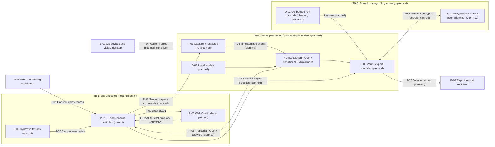

# Data Flow Diagram

## Current Versus Intended Scope

Current: P-01 UI, P-02 Web Crypto, synthetic D-00 fixtures, and a loopback server supplying frontend assets. F-01 is the user's consent/preferences input; F-02 encrypts draft JSON locally and returns an envelope. Everything else below is planned desktop architecture. Trust boundaries TB-1 and TB-2 are intended security boundaries, not implemented isolation in the browser prototype.

TB-1 to TB-2 requires scoped IPC and OS capture permission checks; TB-2 to TB-3 requires least-privilege filesystem/key access and authenticated records. Both remain future controls. Plaintext audio/OCR remains sensitive in runtime memory even if disk storage is encrypted. No cloud inference edge exists by default; adding one requires a revised DFD and explicit user configuration.
