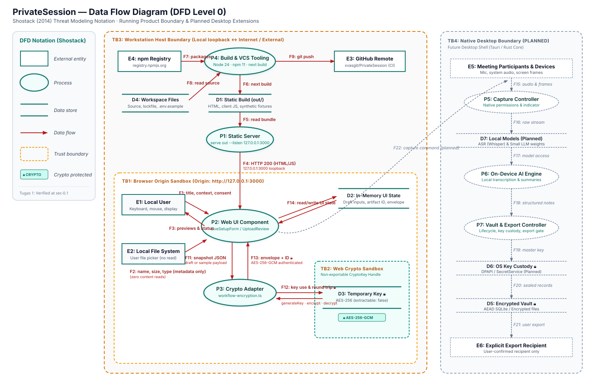

# Data Flow Diagram (DFD Level 0)

> **Notation Reference:** Adam Shostack (2014), *Threat Modeling: Designing for Security*, Chapter 2.  
> **Target System:** PrivateSession (Tugas 1 running prototype & planned native extensions).

---

## 1. Visual Diagram

---

## 2. Diagram Element Inventory

### 2.1 Processes

| ID | Process Name | Runtime / Technology | Status | Description |
|---|---|---|---|---|
| **P1** | Static Web Server | `serve out --listen 127.0.0.1:3000` | Running | Serves statically exported HTML, CSS, JavaScript chunks, and asset files over local loopback TCP. |
| **P2** | Web UI Component | React 19 / Next.js client components | Running | Runs inside browser runtime; manages live setup form validation, metadata-only media selection, and sample review states. |
| **P3** | Crypto Adapter | `lib/crypto/workflow-encryption.ts` | Running | Client-side adapter; serializes input snapshots, requests key generation, invokes Web Crypto AEAD, and verifies recovery. |
| **P4** | Build & VCS Tooling | Node.js 24 · npm 11 · Git · Next.js CLI | Running | Developer workstation tooling used to install packages, build static export (`out/`), run unit/E2E test suites, and push to GitHub. |
| **P5** | Capture Controller | Desktop shell (Tauri / Rust core) | Planned | Manages native OS audio capture, display snapshot streams, and visible recording indicator flags. |
| **P6** | On-Device AI Engine | Local Whisper / ONNX / Small LLM | Planned | Performs on-device speech-to-text, OCR frame extraction, and structured summarization without cloud dependencies. |
| **P7** | Vault & Export Controller | Native application layer | Planned | Manages session lifecycle, persistent master key derivation, encrypted database storage, and explicit user export gating. |

### 2.2 Data Stores

| ID | Data Store Name | Location / Medium | Status | Description |
|---|---|---|---|---|
| **D1** | Static Build (`out/`) | Local file system directory | Running | Statically generated production HTML pages, JS bundles, CSS, and fixed synthetic fixture data. |
| **D2** | In-Memory UI State | Browser tab RAM (`window` context) | Running | Ephemeral React state: draft fields, selected file metadata, displayed sample sections, artifact IDs, and ciphertext envelopes. |
| **D3** | Temporary Key | Web Crypto non-exportable memory handle | Running | Single-operation AES-GCM-256 key (`extractable: false`); generated in CSPRNG, consumed for encrypt/decrypt verification, then discarded. |
| **D4** | Workspace Files | Developer workstation directory | Running | Application TypeScript source, configuration, lockfile (`package-lock.json`), documentation, and `.env.example`. |
| **D5** | Encrypted Session Vault | Local disk (SQLite / encrypted files) | Planned | Durable encrypted database holding past transcripts, extracted notes, and session indexes. |
| **D6** | OS Key Custody | OS secure storage (DPAPI / SecretService) | Planned | Hardware-backed or OS-isolated master key storage for authenticating and sealing local vault records. |
| **D7** | Local Models | Local file system / app bundle | Planned | Verified read-only model weights for local ASR and language models. |

### 2.3 External Entities

| ID | Entity Name | Nature | Status | Description |
|---|---|---|---|---|
| **E1** | Local User | Human end-user | Running | Interacts with the web UI via mouse, keyboard, and screen displays on `http://127.0.0.1:3000`. |
| **E2** | Local File System | Operating system storage | Running | Accessed strictly via browser native file picker (`<input type="file">`); inspected for name/size metadata without reading file content. |
| **E3** | GitHub Remote | Cloud repository & CI platform | Running | Hosted repository (`xvasgit/PrivateSession`) and automated GitHub Actions verification runner. |
| **E4** | npm Registry | Cloud package repository | Running | Public dependency registry (`registry.npmjs.org`) supplying verified package tarballs during `npm ci`. |
| **E5** | Meeting Participants & Devices | Human participants / OS hardware | Planned | Microphone input, system audio output, and desktop screen frame sources. |
| **E6** | Explicit Export Recipient | External human or application | Planned | Destination for user-confirmed, explicitly selected exported meeting summaries or transcripts. |

---

## 3. Data Flow Inventory

| Flow ID | Source | Target | Data Description | Crypto Tag | Crosses Trust Boundary? |
|---|---|---|---|---|---|
| **F1** | E1 (User) | P2 (Web UI) | Title, context, mode, source checkboxes, consent confirmation flag | Plaintext | Yes (User → TB1) |
| **F2** | E2 (File System) | P2 (Web UI) | File metadata only (name, size, MIME type; 0 bytes of content read) | Plaintext | Yes (Host FS → TB1) |
| **F3** | P2 (Web UI) | E1 (User) | Rendered form feedback, sample transcript previews, verification status badges | Plaintext | Yes (TB1 → User display) |
| **F4** | P1 (Server) | P2 (Web UI) | HTTP 200 responses delivering static HTML and bundled JS assets over loopback | Plaintext | Yes (TB3 → TB1) |
| **F5** | D1 (Build) | P1 (Server) | Static file reads from `out/` during HTTP request handling | Plaintext | No (Within TB3) |
| **F6** | P4 (Tooling) | D1 (Build) | `next build` emits compiled and static export bundle into `out/` | Plaintext | No (Within TB3) |
| **F7** | E4 (Registry) | P4 (Tooling) | npm dependency packages downloaded during `npm ci` | Plaintext / TLS | Yes (Internet → TB3) |
| **F8** | D4 (Workspace) | P4 (Tooling) | Reading source code, configuration files, and `package-lock.json` | Plaintext | No (Within TB3) |
| **F9** | P4 (Tooling) | E3 (GitHub) | `git push origin main` sending verified commits and tags | TLS / SSH | Yes (TB3 → Internet) |
| **F11** | P2 (Web UI) | P3 (Crypto Adapter) | Serialized snapshot JSON `{kind, data}` extracted from validated draft or fixed sample | Plaintext | No (Within TB1) |
| **F12** | P3 (Crypto Adapter) | D3 (Temporary Key) | CryptoKey generation, AES-GCM encryption, and decryption verification round trip |  **CRYPTO** | Yes (TB1 ↔ TB2) |
| **F13** | P3 (Crypto Adapter) | P2 (Web UI) | Verified `{artifactId, envelope}` containing algorithm, nonce hex, and ciphertext+tag hex |  **CRYPTO** | No (Within TB1) |
| **F14** | P2 (Web UI) | D2 (UI State) | Two-way read/write access to in-memory component state and encryption results | Plaintext | No (Within TB1) |
| *F15* | E5 (Devices) | P5 (Capture) | Raw microphone audio stream, system audio buffer, and screen capture frames | *Planned* | Yes (External → TB4) |
| *F16* | P5 (Capture) | P6 (AI Engine) | Timestamped audio buffers and video frame buffers routed to inference | *Planned* | No (Within TB4) |
| *F17* | D7 (Models) | P6 (AI Engine) | Model parameter loading and weight reads during inference execution | *Planned* | No (Within TB4) |
| *F18* | P6 (AI Engine) | P7 (Vault) | Structured transcript segments, action items, summaries, and detected questions | *Planned* | No (Within TB4) |
| *F19* | D6 (OS Custody) | P7 (Vault) | Hardware/OS-derived master key retrieval for database encryption and sealing |  **CRYPTO** | Yes (OS Custody ↔ TB4) |
| *F20* | P7 (Vault) | D5 (Vault DB) | Authenticated ciphertext writes and encrypted index query round trips |  **CRYPTO** | No (Within TB4) |
| *F21* | P7 (Vault) | E6 (Recipient) | User-confirmed export archive containing selected transcript or summary sections | *Planned* | Yes (TB4 → External) |
| *F22* | P2 (Web UI) | P5 (Capture) | Consented user capture command and session configuration invocation | *Planned* | Yes (TB1 → TB4) |

---

## 4. Trust Boundaries

| Boundary ID | Boundary Name | Scope & Demarcation | Enforcement & Isolation Mechanism |
|---|---|---|---|
| **TB1** | **Browser Origin Sandbox** | Separates the local web application runtime (`http://127.0.0.1:3000`) from the host operating system and other browser tabs. | Browser Same-Origin Policy (SOP), DOM isolation, renderer process sandbox. No direct raw socket or OS filesystem read capability. |
| **TB2** | **Web Crypto Sandbox** | Separates unextractable cryptographic key memory (`CryptoKey`) from general JavaScript execution contexts and script memory. | W3C Web Cryptography API specification; key generated with `extractable: false`. Key bits cannot be read via `JSON.stringify` or JS reflection. |
| **TB3** | **Workstation Host Boundary** | Demarcates the local developer machine (`127.0.0.1` loopback interface) from external network boundaries (Internet, npm registry, GitHub). | Host OS firewall, network interface binding (`127.0.0.1` vs `0.0.0.0`), TLS transport security for outbound VCS and dependency downloads. |
| *TB4* | *Native Desktop Boundary* | Demarcates the planned native desktop shell (Tauri Rust backend) from the web view and general host system. | Scoped IPC command allowlist, OS privacy permission dialogs (microphone, screen capture), privilege drop. *(Planned)* |

---

## 5. Cryptographic Protection Annotations

In compliance with the official KKS Tugas 1 specification, data assets subject to cryptographic protection are explicitly cataloged below:

| Asset ID | Element / Flow | Cryptographic Primitive | Key Lifecycle & State | Security Objectives |
|---|---|---|---|---|
| **A-02** | D3, F12 | **AES-256-GCM** (256-bit symmetric key) | Ephemeral: created via `crypto.subtle.generateKey`, `extractable: false`. Discarded after single round-trip demonstration. | **Confidentiality & Data Authenticity:** Restricts ciphertext decryption strictly to the operation that generated it. |
| **A-03** | F12, F13 | **AES-256-GCM** (12-byte CSPRNG nonce + 128-bit authentication tag) | Ephemeral envelope: nonce generated via `crypto.getRandomValues`. Bound to `meeting-session:v1:<artifactId>` via AAD. | **Integrity & Authenticity:** Guarantees tamper detection; modifying ciphertext, tag, or AAD causes immediate decryption rejection. |
| *A-12* | *D5, F20* | *AES-256-GCM / XChaCha20-Poly1305* | Persistent vault record encryption. Key derived via Argon2id from master secret. *(Planned)* | **Confidentiality & Integrity:** Protects stored meeting notes and recordings on disk at rest. |
| *A-13* | *D6, F19* | *OS DPAPI / SecretService KEK* | Hardware-backed or user-login-bound key protection. *(Planned)* | **Key Confidentiality:** Prevents unauthorized extraction of vault encryption keys by unprivileged local processes. |
